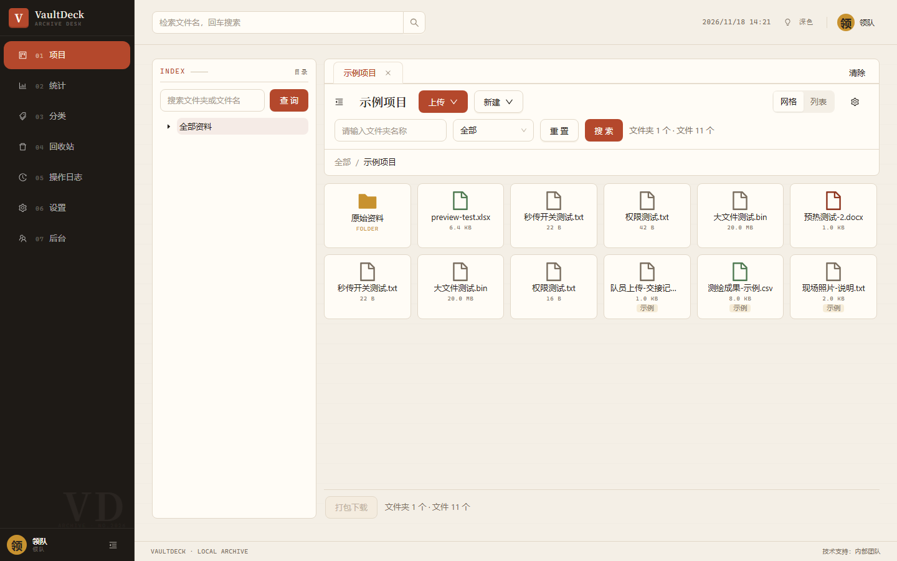
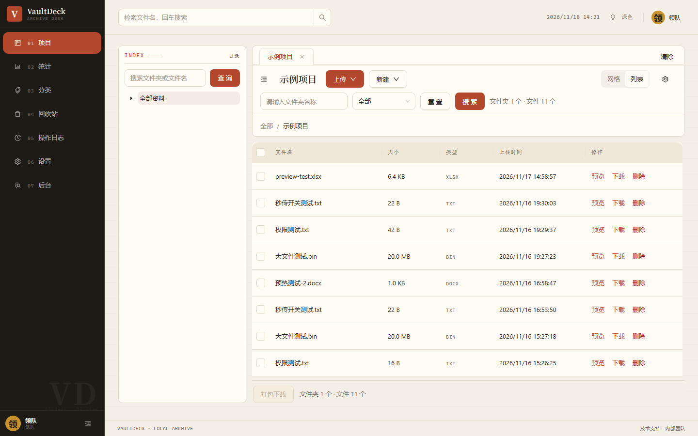
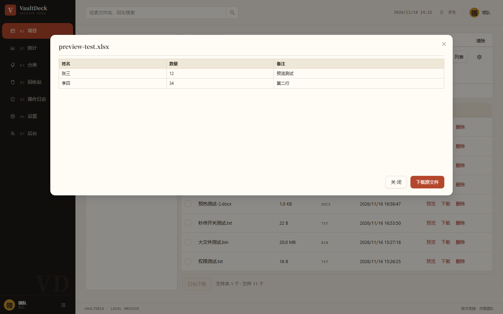
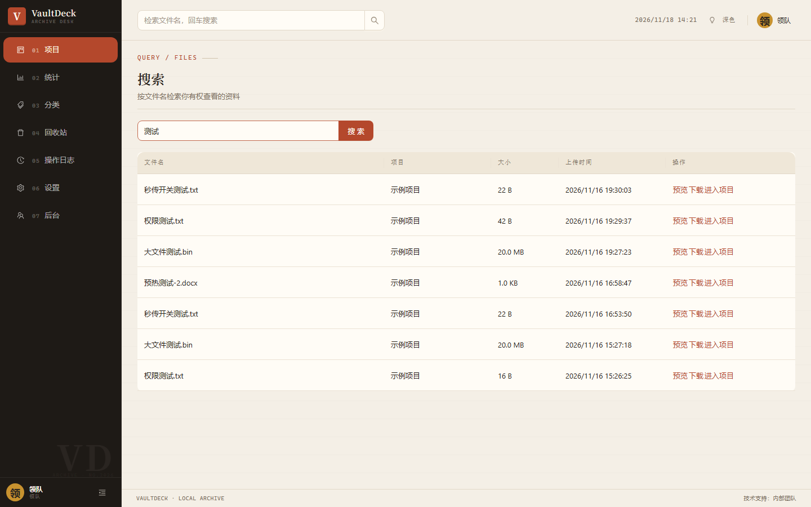
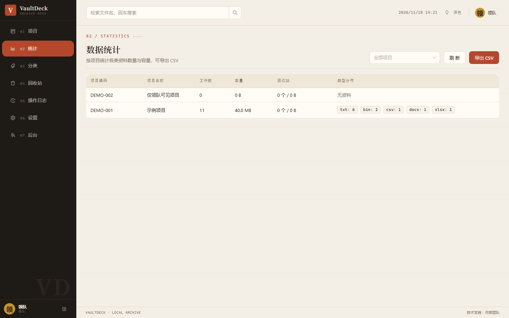
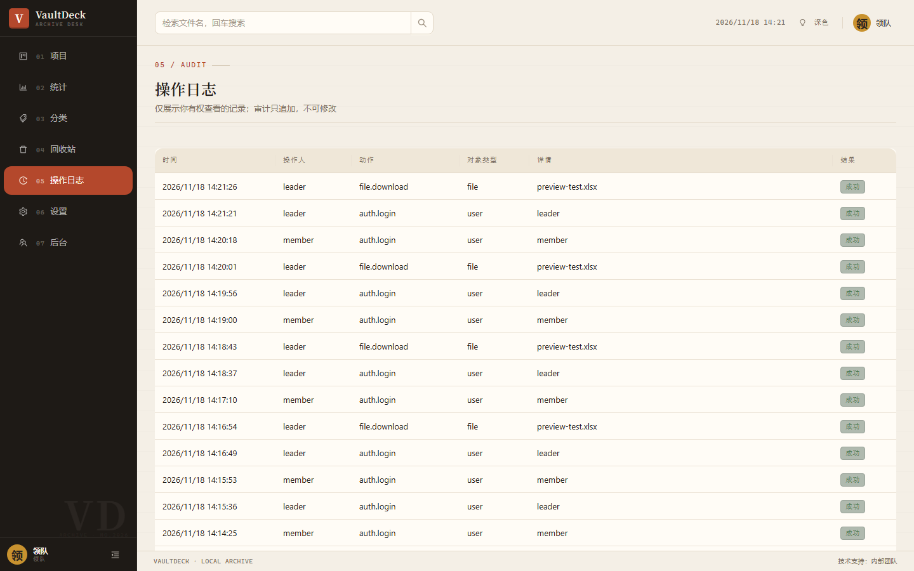
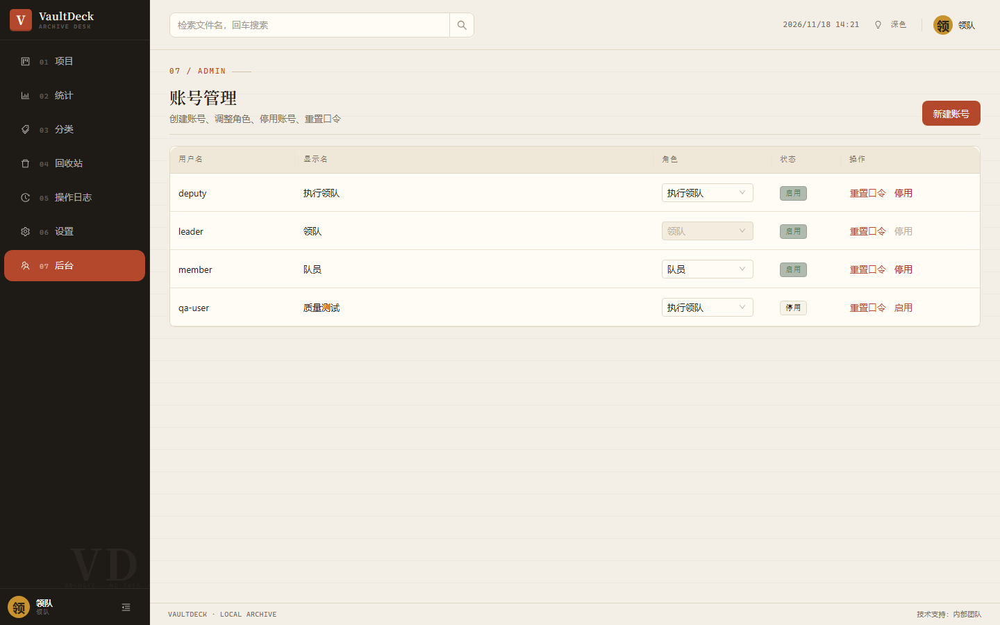
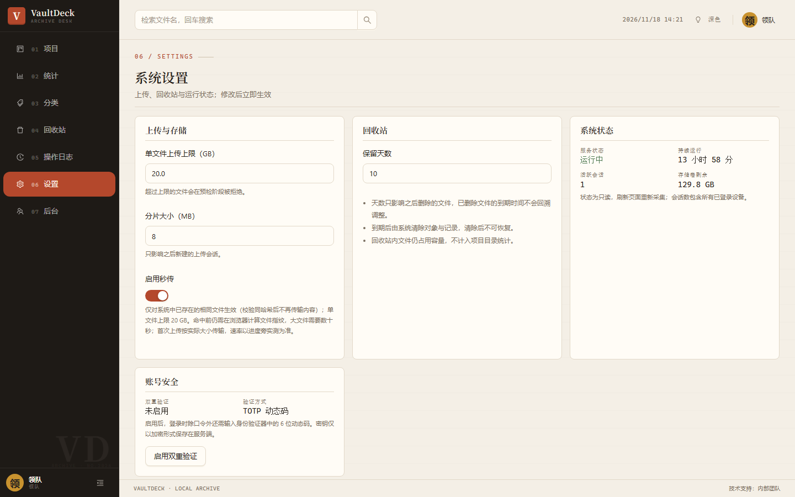
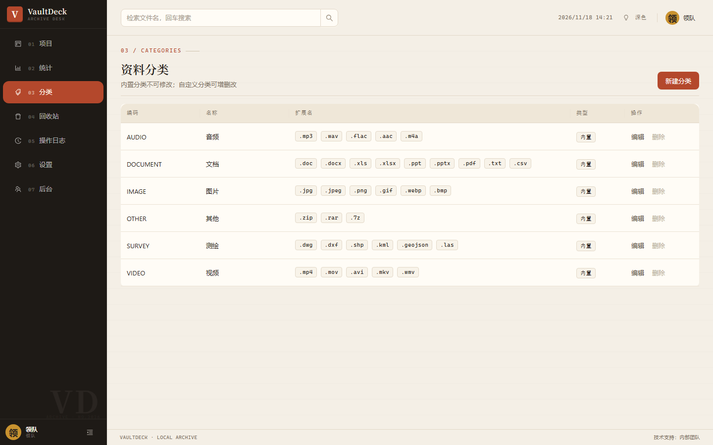
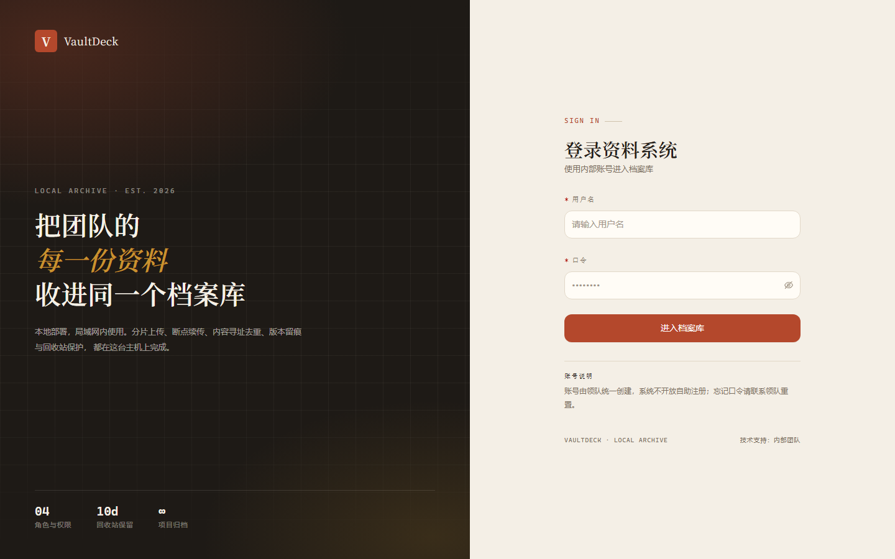

# VaultDeck

局域网内自托管的团队资料管理系统。按项目归档文件，支持分片上传、断点续传、在线预览、权限与审计，部署在单台 Windows 主机上。

[](https://github.com/Echovagant/VaultDeck/actions/workflows/ci.yml)
[](https://github.com/Echovagant/VaultDeck/releases)
[](LICENSE)
[](#)
[](package.json)



## 功能

- **项目与目录**：按项目归档、文件夹树、网格/列表视图、类型筛选、文件名搜索
- **大文件传输**：8 MB 分片、断点续传、Range 下载、SHA-256 秒传、ZIP 打包下载
- **内容寻址存储**：相同内容只保留一份，删除进入回收站，默认保留 10 天
- **在线预览**：PDF、图片、文本由浏览器直接打开；docx 与 xlsx 在浏览器内渲染；pptx 可选服务端 LibreOffice 转换
- **权限**：领队 / 执行领队 / 队员三级角色，项目成员隔离，下载、预览、打包均校验权限
- **审计**：登录、上传、下载、删除、恢复等操作追加写入，只增不改
- **账号**：不开放注册，领队创建账号、重置口令、停用账号；支持 TOTP 双重验证
- **统计**：按项目统计文件数、容量与类型分布，可导出 CSV
- **部署**：Windows 服务 + Nginx TLS，离线包一键安装，可选双向 TLS

## 界面

| 项目与容量                                            | 文件列表                                               |
| ----------------------------------------------------- | ------------------------------------------------------ |
|          |          |
| **文件预览**（xlsx 浏览器渲染）                       | **文件名搜索**                                         |
|      |             |
| **数据统计**                                          | **操作日志**                                           |
|             |              |
| **账号管理**                                          | **系统设置与账号安全**                                 |
|       |  |
| **队员视角**                                          | **资料分类**                                           |
|  |         |

登录页：



## 技术栈

| 层     | 选型                                                       |
| ------ | ---------------------------------------------------------- |
| 前端   | Vue 3 + TypeScript + Pinia + Ant Design Vue                |
| 后端   | NestJS 11 + Fastify                                        |
| 数据库 | PostgreSQL 16                                              |
| 接入层 | Nginx（TLS 终止、静态资源、限流、反向代理）                |
| 预览   | 浏览器原生 + docx-preview + ExcelJS；pptx 可选 LibreOffice |
| 备份   | restic + pg_dump                                           |
| 部署   | Windows 单机 + WinSW 服务                                  |

## 快速开始

### 离线包部署（推荐）

从 [Releases](https://github.com/Echovagant/VaultDeck/releases) 下载 `VaultDeck-v0.1.0-offline.zip`，解压到本机任意目录，在包根目录以管理员 PowerShell 执行：

```powershell
powershell -ExecutionPolicy Bypass -File setup.ps1
```

- 默认部署目录为 `<发布包目录>\VaultDeck`，不存在时自动创建；可用 `-TargetHome <目录>` 指定其他位置。
- 预计 3–8 分钟；第一步会检查系统版本、.NET Framework 4.8、防火墙服务与包内运行时。
- 需要管理员权限注册 Windows 服务、添加入站防火墙规则、写入机器级环境变量并收紧密钥目录 ACL。
- 不会重启电脑，也不会删除部署目录以外的文件；`-DryRun` 只打印计划。

部署完成后访问 `https://localhost:8443/`，初始领队账号与口令见 `secrets\initial-admin.txt`。

### 源码开发

```bash
npm install
```

内存存储模式（重启后数据清空）：

```bash
VD_BOOTSTRAP_DEMO=true npm run dev --workspace @vaultdeck/api
npm run dev --workspace @vaultdeck/web
```

Windows PowerShell 中把 `VD_BOOTSTRAP_DEMO=true` 写成 `$env:VD_BOOTSTRAP_DEMO='true'`。前端默认 `http://localhost:5173`，Vite 将 `/api` 代理到后端。

使用 PostgreSQL 时设置 `VD_STORE=postgres`、`VD_DATABASE_URL`，执行 `npm run db:migrate` 后启动。空库首次使用 `VD_BOOTSTRAP_DEMO=true` 会创建 `leader` / `deputy` / `member` 三个演示账号；仅用于首次初始化，登录后请立即修改口令。

## 性能参考

同一套代码在不同硬件上的差异较大，以下为参考环境实测值，仅作量级参考：

| 环境          | 数据量              | 上传       | 下载       | 备份       |
| ------------- | ------------------- | ---------- | ---------- | ---------- |
| 内置盘        | 20 × 1 GB，10 并发  | 204.5 MB/s | 526.9 MB/s | 266.2 MB/s |
| 外置盘（USB） | 1 GB，单文件        | 23.0 MB/s  | 187.3 MB/s | 38.4 MB/s  |
| 外置盘（USB） | 10 × 10 GB，10 并发 | 22.8 MB/s  | —          | —          |
| 外置盘（USB） | 20 GB，单文件       | 30.6 MB/s  | —          | —          |

表中内置盘为 NVMe SSD，外置盘为 USB 接口；机械硬盘、SATA SSD 与不同 USB 版本会明显不同，请以目标机器实测为准。

## 安全与数据边界

- 传输使用 HTTPS/TLS 1.2+、HSTS 与 CSP；登录会话使用 HttpOnly + SameSite=Strict Cookie。
- 文件对象、上传分片、预览缓存与头像使用 AES-256-GCM 应用层加密，密钥位于部署目录的 `secrets\encryption.key`。
- 数据库中的结构化元数据未做应用层加密，依赖 BitLocker 与目录 ACL；不要把服务直接暴露到公网。
- 加密密钥丢失后历史对象无法解密，必须与备份分开、离线保存。

以下情况无法通过本系统恢复：删除并清空回收站；磁盘或整机损坏且无备份；加密密钥丢失；数据库损坏且无 `pg_dump` 备份；备份仓库口令丢失。**VaultDeck 不是备份系统，不能作为资料的唯一副本。**

详细说明见 [部署手册](docs/ops/deployment.md)。

## 免责声明

本项目按“现状”提供，不附带任何明示或暗示的担保。部署者需自行负责数据备份、访问控制、账号管理以及所在组织的合规要求。

- 因误删、清空回收站、磁盘或整机损坏、密钥丢失、未做备份等原因造成的数据丢失，作者不承担责任。
- 将服务暴露到公网、使用弱口令、转交管理员权限等行为带来的未授权访问或数据泄露风险，由部署者承担。
- 作者不对因使用或无法使用本软件造成的任何直接或间接损失承担责任。

## 目录

```
apps/api         后端服务
apps/web         前端应用
packages/shared  契约生成的类型与共享常量
contracts        OpenAPI 契约
deploy/windows   Windows 发布包与安装脚本
docs             设计、决策与运维文档
scripts          开发、验收、备份与发布脚本
```

## 文档

- 实现方案：`docs/design/design.md`
- 架构决策：`docs/decisions/`
- 运维手册：`docs/ops/deployment.md`

## License

[MIT](LICENSE)
