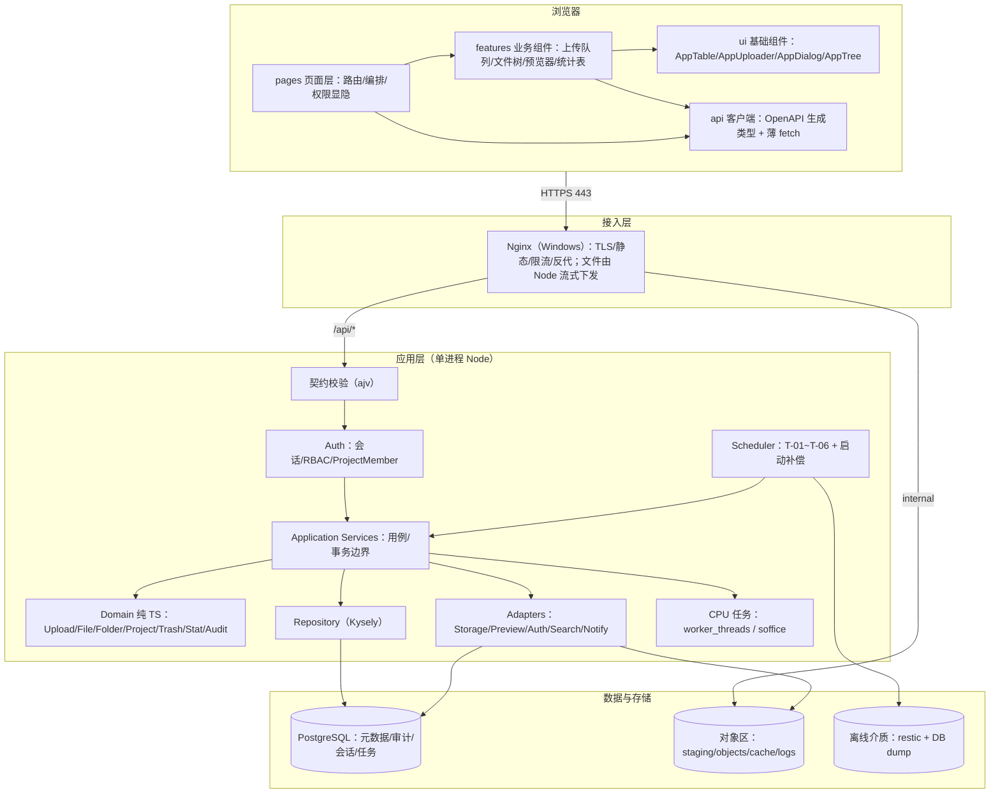
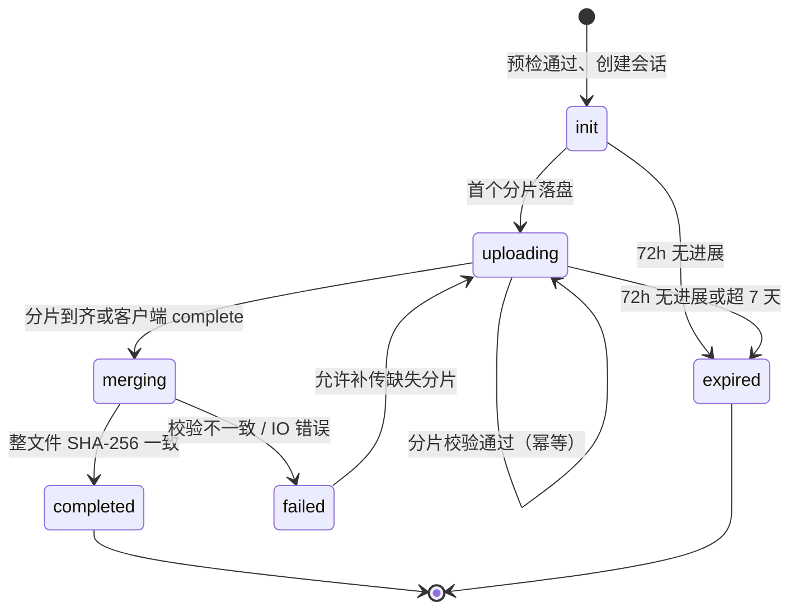
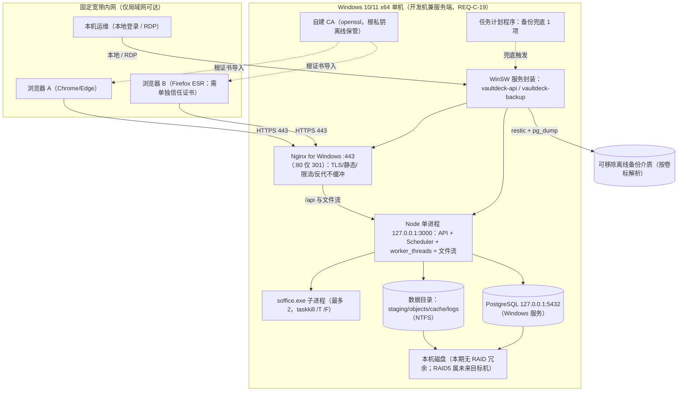

# VaultDeck 实现方案（P2）

| 项          | 内容                                                                                                        |
| ----------- | ----------------------------------------------------------------------------------------------------------- |
| 文档        | 实现方案（design.md），P2 架构与选型；不含业务代码、不产出可运行工程                                        |
| 版本 / 日期 | v0.5 Draft / 2026-11-16（P4 拆解后工期重估）                                                                |
| 上游基线    | `docs/specs/requirements.md`（P1 v0.1 + Windows 修订：C-19/20/21、N-08、N-18、F-58）；`tasks.md`（P4 v1.0） |
| 下游        | tasks.md（spec-task-agent）、实现与验收                                                                     |
| 量化口径    | 沿用 P1 §1.5：L1 厂商规格 / L2 公式推导 / L3 待实测；性能与并发一律 L3                                      |

**阅读指引**：5 分钟只看 §0；关心"为什么"看 §2 与 `docs/decisions/`；关心"怎么做"看 §3、§5、§6；关心"能否上线"看 §9–§11。

## 0. TL;DR 选型总表

**一句话**：在**单台 Windows 主机**（个人开发机兼局域网服务端，REQ-C-19）上跑"一个 Node 后端 + 一个 PostgreSQL + 一个 Nginx"，前端 Vue3 SPA 静态托管；文件为内容寻址对象 + 8 MiB 分片；预览为"前端 PDF 渲染 + 后端 Office 转 PDF 缓存"；搜索不引 ES 而用 PostgreSQL trigram；外部能力收口到 5 个 Adapter；部署层以 WinSW 封装为 Windows 服务，大文件由 Node 流式下发（Windows 版 Nginx 无 `sendfile`）；API 以手写 OpenAPI 3.1 为唯一事实源并双向生成类型。**业务模块不感知操作系统**（REQ-C-20）。

| 领域        | 结论                                            | 备选                               | 一句话理由                                                                  | 替换成本（单人）                 |
| ----------- | ----------------------------------------------- | ---------------------------------- | --------------------------------------------------------------------------- | -------------------------------- |
| 前端框架    | Vue3 + TS + Element Plus（P1 既定）             | React+AntD、Svelte                 | 用户已定，覆盖上传/树/表格三大重场景                                        | 组件库 1–3 天（只改 `ui/`）      |
| 后端框架    | NestJS（TS，Fastify 适配器）                    | Spring Boot、Go/Gin、FastAPI       | 单语言贯穿前后端，契约与类型链路最短                                        | 骨架 3–5 天，业务零改动          |
| 数据库      | PostgreSQL 16                                   | SQLite、MySQL/MariaDB              | 并发写 + 聚合 + 部分索引 + 行级权限，一步到位                               | 3–8 天（限 Repository）          |
| 数据访问    | Kysely + 手写 SQL 迁移                          | Prisma、TypeORM                    | 类型安全且 SQL 可见，无额外引擎二进制                                       | 1–2 天                           |
| 反向代理    | Nginx for Windows（**大文件由 Node 流式下发**） | Caddy on Windows、Traefik          | Windows 构建无 `sendfile`/单 worker；Node 流式 20 并发可控且可即时断流      | 1 天（配置）+ 流式已内置         |
| PDF 渲染    | pdf.js（本地打包）                              | 浏览器内置 viewer                  | 离线可控、支持 Range、能接鉴权网关                                          | ≤1 天（Adapter）                 |
| Office 预览 | LibreOffice headless 转 PDF + sha256 缓存       | OnlyOffice/Collabora、纯前端       | 保真最高且完全离线；文档服务器过重                                          | ≤1 天（Adapter）                 |
| 搜索        | PostgreSQL `pg_trgm` + `ILIKE`                  | Elasticsearch、Meilisearch         | 十万级不值当第三套服务；权限过滤同库完成                                    | ≤1 天（Adapter）                 |
| 认证        | 服务端会话 + HttpOnly Cookie                    | JWT、AD/LDAP                       | "停用立即失效"有状态最简单                                                  | ≤1 天（Adapter）                 |
| 口令        | Node 内置 `scrypt`                              | Argon2id、bcrypt                   | 零 native 编译依赖，离线零风险                                              | ≤0.5 天                          |
| 定时任务    | 进程内调度 + `job_run` + advisory lock          | BullMQ/Redis、任务计划程序         | 单实例不需队列中间件；补执行需 DB 记录；计划程序仅作备份兜底                | ≤1 天                            |
| 备份        | restic + `pg_dump -Fc`                          | borg、rsync+tar                    | 加密、增量去重、`check` 校验、介质友好                                      | ≤1 天（脚本层）                  |
| 部署        | Windows 10/11 单机 + WinSW 服务 + 目录发布      | Linux 服务器、Docker Desktop、NSSM | 本期仅一台 Windows 主机（REQ-C-19）；WinSW 单文件封装、崩溃重启、免登录会话 | 3–5 天（迁移 Linux，业务零改动） |
| API 契约    | 手写 OpenAPI 3.1 + 双向类型生成                 | 代码优先注解                       | 契约先行是低返工前提，前后端可并行                                          | ≤1 天                            |
| 打包下载    | 自研可定位 ZIP（ZIP64+STORE）                   | archiver、落盘任务包               | 同时满足"不落盘副本"与"断点续传"                                            | 3–5 天（高风险，§3.2）           |

**关于"1 工作日回退"**：适配层（预览/搜索/认证/备份/调度/存储）全部 ≤1 天；**骨架层**（框架/数据库/部署）不可能 1 天替换，故把业务改动压到 0、替换的是"架子"，在 §2.11 与各 ADR 如实标注，不做虚假承诺。

**运行环境前提（REQ-C-19/20/21）**：本期全部开发、演示与验收在**同一台 Windows 主机**完成，不假设 Linux、systemd、POSIX 权限位或 RAID5 已就位；Linux 仅作为"未来目标机"的等价迁移路径保留（§7.6 与 `ADR-007`）。所有部署细节在 Windows 下的取舍见 §2.4、§7、`ADR-007`。

## 1. 架构总览

### 1.1 分层图



### 1.2 模块边界

| 层                 | 允许依赖                                | 禁止依赖                                 | 理由                     |
| ------------------ | --------------------------------------- | ---------------------------------------- | ------------------------ |
| `domain/`          | 纯 TS 类型与领域服务                    | Nest 装饰器、Kysely、任何 SDK、HTTP 类型 | 换实现不改业务的最后屏障 |
| `application/`     | `domain`、Repository 接口、Adapter 接口 | 具体驱动、外部 CLI                       | 只决定事务与审计点       |
| `infrastructure/`  | Kysely、fs、子进程、restic CLI          | domain 内部实现                          | 可整体替换               |
| `interfaces/http/` | 生成 DTO、契约校验、鉴权                | 直接写 SQL                               | 入口薄，业务在应用层     |
| 前端 `ui/`         | props / slots / emit                    | Pinia、api、router、业务枚举             | 组件库替换只改这层       |

### 1.3 单体为何优于微服务

① **规模不成立**：50 账号/20 活跃/10 上传/20 下载，微服务最小可观测成本远大于收益。② **一致性**：删除入回收站、恢复、物理清除、引用计数、审计必须同事务，单体 + 单库一个本地事务闭环；拆服务需分布式事务或补偿，单人不可控。③ **单机硬件**：16C/32T、64 GB 上的进程隔离是伪隔离，反把内存切成多份固定堆。④ **低返工**：用"域/应用/基础设施"三重边界获得可替换性；跨模块只经应用服务接口、不访问对方表（§4.3），未来拆分点即接口。⑤ **否决**：多进程微服务（运维与一致性成本 > 收益）、Serverless（无法离线）、桌面端内嵌服务（与"浏览器为主 + 多用户"冲突）。

## 2. 技术栈选型与理由

通用原则：**离线优先**（REQ-N-33/34）、**少组件优先**（每多一个常驻服务 = 一份运维负担 + 一份离线包）、**可替换优先**（REQ-C-10）、**可验证优先**（不可实测即标 L3）。

### 2.1 前端

Vue3 + TS（Composition API）/ Vite / Pinia（仅页面级）/ Vue Router（history）。组件库 Element Plus（备选 Ant Design Vue 更重、Naive UI 成熟度略低）。预览 pdf.js 自托管 worker 与 cmaps，兜底 docx-preview + SheetJS（动态 import）。上传为自研分片上传器（基于 `ui/AppUploader`），否决 `el-upload` 直用（无法控制分片协议、秒传、幂等）。否决 Webpack（配置与时长）、Nuxt（无 SSR 需求却增服务端复杂度）、Vuex（已过时）、Hash 路由（无收益）、浏览器内置 PDF viewer（跨浏览器不一致、无法注入鉴权）、任何遥测/打点（REQ-N-33）。**三层纪律**（REQ-C-13）：`pages` 只做路由与编排，`features` 持有业务状态，`ui` 只吃 props/slots；ESLint 强制方向（禁 `ui→features`、`ui→api`、`features→pages`）。替换边界：组件库换只重写 `ui/`，1–3 天。

### 2.2 后端框架

**结论**：NestJS 11 + TS on Node 24 LTS，单进程，Fastify 适配器。**理由**：① 与前端同语言同类型，契约生成类型两侧共用（REQ-C-11 成本最低）；② 模块/DI 与四层架构吻合，Adapter 注入点清晰；③ `stream.pipeline` 直落盘，10 并发 8 MiB 分片内存可控（§9.1）；④ `pnpm fetch` 离线 store 随发布包分发。**配套硬约束**：SHA-256/合并/ZIP/转换/导入不跑主事件循环（worker_threads 或子进程）；ESLint 禁同步 `fs`；不启用 cluster（多进程时靠 DB 锁兜底）。**否决**：Spring Boot（两套语言与类型体系，工期 +20%~30%，L3 估算）、Go/Gin（部署最简但契约与类型共享需额外生成层）、FastAPI（离线依赖与长期运行更脆弱）、微服务/Serverless（§1.3）。**替换边界**：`domain/`/`application/` 不引 Nest 符号，替换只重写 HTTP 层与装配，3–5 天（L3），业务零改动。

### 2.3 数据库与数据访问

**结论**：PostgreSQL 16 单实例 + Kysely + 手写 SQL 迁移（`migrations/NNNN_xxx.up.sql`/`.down.sql`）。**理由**：① 并发写真实存在（10 上传写会话/分片、20 下载写审计、统计与清理并发），SQLite 单写者不可接受；② 需要的能力齐备（部分索引、表达式索引、trgm GIN、窗口函数、`pg_advisory_lock`、`REVOKE UPDATE/DELETE`）；③ `pg_dump -Fc`/`pg_restore` 成熟；④ 手写 SQL 可评审、`down` 可演练。**否决**：SQLite（单写者，未来换库更难）、MySQL（部分索引/`RETURNING`/JSONB 更弱）、Prisma（引擎二进制体积与升级即换引擎）、TypeORM（实体类型穿透业务层）、Redis（为一个 50 人系统多一个常驻服务）。**Windows 落地**：官方 x64 二进制归档（zip）+ `pg_ctl register` 注册为 Windows 服务，数据目录与程序目录分离；`pg_trgm` 随 contrib 提供；`shared_buffers` 8 GB 在 Windows 仍可用（无大页，性能略低于 Linux，L3 待实测）。**替换边界**：SQL 只在 `infrastructure/persistence/**`，Repository 返回领域对象；换库 = 改实现 + 迁移 + 方言差异，3–8 天（L3）→ `ADR-002`。

### 2.4 反向代理（Windows 取舍）

**结论**：保留 **Nginx for Windows**，但收缩职责为"TLS 终止 + 静态资源 + API 反代 + 限流"；**大文件下载不再依赖 `X-Accel-Redirect`，改由 Node 流式下发**（`proxy_buffering off`、`proxy_request_buffering off`）。

**理由（如实说明平台限制）**：① Windows 构建使用 `select` 模型与单 worker，连接扩展性弱于 Linux 的 `epoll`；② 不支持 `sendfile`/`aio` 的原生零拷贝语义，`sendfile` 参数在 Windows 上被忽略，文件实际走用户态读写；③ HTTP/2 在 Windows 构建上的可用性需 M0 实测确认（若不可用，前端并发上传退化为 HTTP/1.1 的 6 连接上限，分片并发 3 仍可接受）。因此让 Nginx 承担大文件下发只会得到"多一次用户态拷贝 + 单 worker 瓶颈"，不如让 Node 直接 `createReadStream` 输出：每流固定 64 KiB 缓冲，20 并发 ≈1.25 MiB 额外内存（L2），并且**应用层可在权限变更时主动 `destroy()` 连接**——反而补上了 Linux `sendfile` 方案里"停用后无法掐断已建连下载"的缺口（原 R7 因此降级）。

**否决**：Caddy on Windows（Go 网络栈与 Windows 二进制质量更好，但无 `X-Accel` 等价机制，需 `forward_auth` + `file_server` 做"鉴权端点 + 路径映射"，路径暴露面与审计时序更难保证；作为备选，替换成本 ≤1 天配置，Node 流式代码不变）；Traefik（动态配置对单机是负担）；Node 直接终止 TLS（失去统一证书/限流/静态缓存层）。

**替换边界**：`deploy/nginx/` 与 `deploy/caddy/` 二选一，配置层 1 天；文件下发逻辑在应用内，与代理无关，切换代理不影响下载语义。

### 2.5 预览引擎

**结论**：混合 + 严格降级（§3.4）：PDF → pdf.js；Office 全系 → LibreOffice 转 PDF（sha256 缓存）；转换失败 → 前端轻渲染（仅 docx/xlsx）；仍失败 → 提示 + 下载入口。**理由**：LibreOffice 是唯一"完全离线 + 覆盖 doc/docx/xls/xlsx/ppt + 保真可接受 + 无授权争议"的选项；PDF 快照对"只看"足够（P1 非目标：不做协同编辑/批注）。**否决**：OnlyOffice/Collabora（额外常驻服务 + 2 GB 内存 + 授权与部署复杂度）、纯前端作主方案（docx 保真差、老格式不支持、大 xlsx 卡死主线程）、云转换（违反 REQ-N-33）、栅格化为图片（丢文字层、转换更慢）。**替换边界**：`PreviewPort` 仅 3 方法，换引擎只换实现与部署包，≤1 天 → `ADR-003`。

### 2.6 搜索

**结论**：不引搜索引擎。`lower(file_name)` 建 `gin_trgm_ops` 索引 + `ILIKE`；筛选走组合 B-tree；权限在 SQL 内前置。**理由**：需求只有"文件名子串、不区分大小写"（REQ-F-21）；权限过滤与检索同库同 SQL，天然不泄露越权条目（REQ-F-22），无需两套系统同步权限视图；按 3 年 20 万文件（L3 假设）trgm 可满足 2 s；少一个常驻服务 = 少一份内存、备份与升级风险。**否决**：Elasticsearch（JVM 常驻 2–4 GB、离线包 500 MB+、需独立备份与权限同步）、Meilisearch（中文需分词配置、权限需二次回查 DB、同步延迟）、PG `tsvector`（中文需编译 `zhparser`，离线分发成本高，且需求是子串非分词）。**已知局限**：<3 字符无法用 trgm，退化为顺序扫描（§3.5 缓解）。**替换边界**：`SearchPort` 单方法，≤1 天（不含索引回填）。

### 2.7 认证与口令

**结论**：服务端有状态会话（`session` 表 + 256 bit opaque token，DB 存 `SHA-256(token)`），Cookie `HttpOnly; Secure; SameSite=Strict`；口令用 Node 内置 `scrypt`（`N=2^15,r=8,p=1`，哈希串带版本前缀）。**理由**：① 停用/删除/改密需"立即终止所有会话"（REQ-P-08/F-41），删会话行即生效，JWT 需黑名单更绕；② 8 h 空闲失效只需 `last_seen_at`；③ 50 账号单实例，每请求一次主键查询（微秒级）不是瓶颈，故**不做会话缓存**换取确定性；④ `scrypt` 内置，避免 native 编译（离线无工具链是硬风险）。**否决**：JWT（撤销弱）、AD/LDAP（OQ-11 关闭）、OAuth/SSO（非目标）、bcryptjs（纯 JS 慢）。**替换边界**：`AuthPort` 7 方法，接目录只改 `authenticate`，≤1 天。

### 2.8 定时任务

**结论**：进程内调度（分钟 tick）+ `job_run` + `pg_advisory_lock` 互斥 + 启动补偿扫描；关键任务同时暴露 CLI（`vaultdeck job run <name>`）。**理由**：六个任务都是"低频 + 需可追溯 + 需补偿"的**有状态任务**而非高吞吐队列；单实例无需 Redis；补偿由"上次成功 vs 应执行"驱动，重启不漏（REQ-N-21）；`job_run` 支撑"连续 2 次失败告警"与健康视图（REQ-N-29）。**Windows 落地**：Node 定时器可用，但休眠/睡眠会导致 timer 漂移，故每 tick 用墙钟时间比对 `job_run.scheduled_at`（而非累加计时），并在系统 `resume` 后立即补扫；**任务计划程序仅注册 1 个"备份兜底"任务**（API 服务未运行时直接调用备份 CLI），不承担主调度，避免与进程内调度双跑。**否决**：BullMQ+Redis（为一个每日任务引中间件）、纯任务计划程序（状态/失败/补偿/审计仍要自写，视图割裂，且需存登录凭据）。**替换边界**：`SchedulerPort.register` + `JobRunner`，≤1 天 → `ADR-005`、`ADR-007`。

### 2.9 备份工具

**结论**：restic（单二进制）备份对象区与预览缓存清单，`pg_dump -Fc` 备份数据库，由 T-05 编排产出"快照清单 + 校验报告"；仓库加密、密钥离线保管。**理由**：单静态二进制、无运行时依赖（Windows x64 版本同样单文件）；增量 + 内容去重 + 快照 + `check` 校验；AES-256 加密使介质可携带；本地挂载介质（OQ-12）支持完善；`-Fc` 支持选择性恢复与并行恢复（利于 RTO）。**Windows 落地**：盘符会随插拔变化，**备份目标按卷标/GUID 解析**，不写死盘符；restic 不在文件系统层做快照（无 VSS 依赖），依赖"对象不可变 + 数据库用 `pg_dump` 而非文件拷贝"来保证一致性。**否决**：borg（Python + C 扩展，离线部署面更大）、rsync+tar（无加密/无内容校验/恢复粒度差）、PG WAL PITR（对单人过重，RPO 24 h 不需要）、商业软件（无采购）。**替换边界**：两个脚本薄封装，≤1 天，数据格式不变 → `ADR-006`。

### 2.10 部署形态与离线交付（Windows 优先）

**结论**：**Windows 10/11 x64 单机 + WinSW 服务封装 + 目录发布**（`releases/<ver>/` + `current.txt` 指针文件；不使用符号链接，避免开发者模式/管理员权限依赖）。**服务器上不构建，只安装与重启**；构建可在同一台机器或另一台机器完成，产物以 zip + `SHA256SUMS` 交付。

| 组件          | Windows 落地                                                                                                                                            |
| ------------- | ------------------------------------------------------------------------------------------------------------------------------------------------------- |
| 进程守护/自启 | **WinSW**（单 exe + XML）：注册为 Windows 服务、崩溃按策略重启、日志重定向到文件、不依赖用户登录会话；否决 NSSM（维护停更）、任务计划程序（无守护语义） |
| Node 运行时   | 官方 `win-x64` zip 解包到 `runtime\node\`（不用安装器与全局 PATH）；应用依赖用 `pnpm fetch` 离线 store、前端用 `vite build` 产物，一并随包分发          |
| PostgreSQL    | 官方 x64 二进制归档 + `pg_ctl register` 注册服务；数据目录在 `${DATA_ROOT}\pgdata`                                                                      |
| Nginx         | Windows 构建，解包运行；仅 TLS/静态/反代/限流（§2.4）                                                                                                   |
| LibreOffice   | 官方 Windows MSI 离线安装；`soffice.exe --headless` 子进程调用（§3.4）                                                                                  |
| restic        | 官方 Windows x64 单二进制                                                                                                                               |
| 证书          | `openssl`（随构建工具或独立二进制）生成 CA 与服务器证书；客户端用 Windows 证书管理器导入根证书                                                          |
| 定时兜底      | 任务计划程序仅注册"备份兜底"1 项                                                                                                                        |

**否决**：Linux 服务器（REQ-C-19：仅一台 Windows 主机，不为项目维护第二台机器）、Docker Desktop（需 WSL2 虚拟化、离线镜像体积大、单机无编排收益、文件 IO 跨虚拟化层更慢）、K8s（规模不匹配）、PM2（需全局 npm 包，WinSW 已覆盖守护）。

**Linux 等价迁移**（REQ-C-20 预留，不在本期交付）：WinSW → systemd unit；`pg_ctl register` → `postgresql.service`；Nginx for Windows → Linux Nginx（可恢复 `X-Accel-Redirect` 零拷贝）；任务计划程序 → systemd timer / cron；restic、证书、目录结构不变。

### 2.11 回退成本汇总（对齐 REQ-C-14）

| 类别     | 组件                          | 回退方式                     | 成本（L3） | 满足 ≤1 工作日                           |
| -------- | ----------------------------- | ---------------------------- | ---------- | ---------------------------------------- |
| 适配层   | 预览/搜索/认证/备份/调度/存储 | 换实现 + 装配一行            | 0.5–1 天   | 是                                       |
| 前端     | UI 组件库                     | 重写 `ui/` 层                | 1–3 天     | 部分：基础替换 1 天可上线，全量视觉 3 天 |
| 依赖库   | 校验/日志/时间库              | 直接替换                     | ≤0.5 天    | 是                                       |
| 版本回退 | 应用版本                      | 切回上一 release + DB `down` | ≤1 天      | 是（迁移须可逆，§7.3）                   |
| 骨架     | 后端框架                      | 重写 HTTP 层与装配           | 3–5 天     | 否，业务零改动                           |
| 骨架     | 数据库                        | 改 Repository + 迁移         | 3–8 天     | 否，业务零改动                           |
| 骨架     | 部署形态                      | 迁移 Windows ↔ Linux         | 3–5 天     | 否，应用代码零改动                       |

## 3. 关键设计

### 3.1 分片上传

**参数**（存 `setting`，仅 Leader 可改）：`chunk_size` 8 MiB（REQ-N-12 恢复粒度 ≤8 MB，固定值让幂等与合并最简单）；每文件并发 3；每会话文件并发 3；72 h 无进展过期 + 7 天硬上限（REQ-N-14，防僵尸会话）；合并并发 2（§9.2）；语境 A 单文件 20 GB、语境 B 500 个/100 GB（OQ-04）。20 GB / 8 MiB = **2560 片**（L2：20×128）。



① **预检与秒传**：客户端在 Worker 内流式计算整体 SHA-256（须显示进度、可关闭）。`POST /upload-sessions/precheck` 三态：`instant`（同 sha256 + 同 size 的对象已存在 → 建 file 记录 + `ref_count+1`，**不传正文**，REQ-F-08）/ `resume`（同 uploader+name+size+sha256 的未完成会话 → 返回 `sessionId` + `received_chunks`，REQ-F-04）/ `new`（建会话）。秒传是 Optional feature，设置可关。
② **分片**：`PUT /upload-sessions/{id}/chunks/{index}`，`application/octet-stream` 裸二进制（不用 multipart：无 boundary 开销、单片定长、Nginx `client_max_body_size 9m` 可精确、易边写边校验），头带 `Digest: sha-256=<base64>`。
③ **落盘**：`stream → staging/{sessionId}/{index}.part`（先 `.tmp` 再 `rename`），边写边算 sha256；与 `Digest` 不符 → 删临时文件 + `VD-UPL-002`，**不计已接收**。
④ **幂等**（REQ-F-38）：`file_chunk` 已存在且校验一致 → 200；校验冲突 → 409 `VD-UPL-003`，要求刷新进度后重传。
⑤ **进度**：`GET /upload-sessions/{id}` 返回位图 + 已完成字节；前端本地按分片回执推进（刷新 ≤2 s 由前端定时器保证，REQ-F-03，不轮询服务端）。
⑥ **合并与校验**（REQ-F-39）：受合并信号量限制，按序 `createReadStream` 逐片 append 到 `objects/.tmp/{sha256}.blob`，**同时增量算整文件 sha256**（一次读，避免二次全量读）；`fsync` → 比对 → 不一致则 `failed` 并保留分片供定位；一致则 `rename` 到最终路径（同卷原子）→ 写 `object` → 建 `file` → 审计 → 异步删 staging（失败由 T-02 兜底）。
⑦ **残留与暂停**：T-02 每小时清过期会话（先删 chunk 行与 staging 再置 `expired`，连续 2 次失败告警）；暂停只是客户端停止请求，**不额外占容量**（REQ-F-07），staging 计入语境 E（§9.2）。

| 异常                            | 处理                                                           |
| ------------------------------- | -------------------------------------------------------------- |
| 白名单外/超上限/命名违规        | 预检即拒（`VD-VAL-001/002/003`），不建会话、不残留（REQ-F-05） |
| 分片索引越界 / 会话过期或已完成 | 400 `VD-VAL-004` / 410 `VD-UPL-005`（提示重新预检）            |
| 存储余量 <5%                    | 503 `VD-STOR-001`（REQ-N-04）                                  |
| 客户端 hash 失败/超时           | 降级为 `new` 会话，本次无秒传                                  |

### 3.2 下载

**单文件**（流式 + Range + 审计，Windows 下不依赖 `X-Accel-Redirect`）：`GET /files/{id}/content` → Nginx（TLS/反代，`proxy_buffering off`）→ Node 校验会话/权限/`status=active` 并**在响应头下发前写审计** → Node 用 `createReadStream(path, {start, end})` 输出，自行实现 `Range`/`Accept-Ranges`/`206`/`Content-Range`/`416`。每流固定 64 KiB 缓冲，20 并发 ≈1.25 MiB（L2）；`ETag` = sha256 前 16 字节，`If-Range` 判断对象是否被替换；`Content-Disposition` 用 RFC 5987 编码中文名（不落临时文件）；客户端断开或账号被停用时可直接 `stream.destroy()`，**下载可被立即终止**（原 R7 缺口因此关闭）。**性能影响**：失去内核零拷贝，多一次用户态拷贝，单口千兆下目标聚合 ≥80 MB/s（REQ-N-08，L3 待实测）；若未来迁移 Linux，可切回 `X-Accel-Redirect` + `sendfile`（`deploy/nginx/` 内切换，应用只需返回头，属于已预留分支）。

**打包下载**（REQ-F-09/10/11 三条同时成立，本期最难）：

| 约束                        | 冲突                             | 对策                                                                                                    |
| --------------------------- | -------------------------------- | ------------------------------------------------------------------------------------------------------- |
| 不落盘全量副本（P1 语境 C） | 常规 zip 需先算 CRC 与中央目录   | **STORE 模式**：条目直接从源文件偏移拷贝；CRC32 与大小**入库时已算**（`file.crc32`，新增字段）          |
| 支持 Range 续传             | 中央目录在末尾，偏移依赖前序条目 | 条目顺序固定（`folder path + file_name`），偏移**可预计算**；`Range: bytes=N-` 定位到条目内偏移继续输出 |
| 30 s 内开始输出             | 等全部读完才写                   | 逐条目 `createReadStream(start)`；首字节在权限校验 + 偏移计算后立即发出                                 |
| 排队需明示（REQ-F-10）      | 并发打包打满磁盘读               | 并发上限 2，第 3 个起 `202 + queuePosition + etaSeconds`                                                |

> **风险**：自研可定位 ZIP 是难度最高的单点（3–5 天，L3）。M2 末若未通过"断点续传 + 大文件 + UTF-8 中文名"三项测试 → 回退 `bundle.mode=spool`（落盘临时区、保留 2 h、支持 Range），**功能不降级**，代价是临时空间与清理逻辑。

**CSV 导出**：流式 `text/csv; charset=utf-8` + UTF-8 BOM（Excel 直开不乱码），游标分页；先按当前用户权限生成 `WHERE`，禁止越权行。

### 3.3 存储布局

```
${DATA_ROOT}/
├── staging/{sessionId}/{index}.part                     # 未完成上传（计入语境 E）
├── objects/{sha256[0:2]}/{sha256[2:4]}/{sha256}.blob    # 内容寻址、不可变
├── objects/.tmp/                                        # 合并临时（与 staging 短时双份）
├── cache/preview/{sha256}.pdf                           # Office→PDF（LRU）
├── tmp/                                                 # 打包 spool 回退模式
├── backups/                                             # 备份暂存（最终迁至离线介质）
└── logs/                                                # 应用日志（30 天滚动）
```

① **对象不可变**：合并 `rename` 后置"只读"（Windows 只读属性，等价性弱于 POSIX 权限位，见 ADR-007）；对象永不原地改写，变更产生新对象 + 引用切换。② **内容寻址**：路径由 sha256 决定，天然支持秒传、去重与"多项目引用不复制"（REQ-F-34）。③ **两级分片目录**：256×256 = 65536 桶；按 100 万对象估算约 15 个/桶（L2），远低于目录性能拐点。④ **引用计数**：`file_object_ref` + `object.ref_count`；物理删除条件 = `ref_count=0` **且** 无 trash 引用 **且** 无进行中会话；事务内更新 + `CHECK (ref_count>=0)`。⑤ **"分片高安全存储"的工程化解释**：完整性（分片级 + 整文件 sha256 + 月度巡检）、隔离（staging/objects 分离、外部无 URL 直达）、不可猜（路径基于内容哈希，不暴露 fileId→路径映射）、最小权限（服务账户 + 数据目录 ACL，应用层不提供对象删除接口，删除统一经引用归零 + 清理任务）。**不做内容静态加密（D2 已定，REQ-C-21）**：加密会使 Range 与流式下发失效、CPU 成为千兆链路瓶颈；机密性由"内网 + 物理安全 + 备份加密 + 权限"承担，后续如需"磁盘离线即不可读"以 **BitLocker 全盘加密**作为对应 LUKS 的可选方向，不作为本期交付项。

**容量核算**（L2，沿用 P1 §6.1）：Raw 24 TB → RAID5 可用 24×2/3 = 16 TB ≈14.55 TiB → ×(1−2%) ≈14.26 TiB → ×(1−20%) ≈ **11.41 TiB**；语境 E（staging + 回收站 + 临时）≤10% ≈ **1.14 TiB**；预览缓存建议配额 200 GB（LRU）。**未上机验证**，上机后以实际可用块重算并回填 §9.5。

### 3.4 预览

降级顺序（严格按序，必须给出可读原因，REQ-F-27）：

| 序  | 类型                   | 实现                                  | 预算（L3）         | 失败判定                |
| --- | ---------------------- | ------------------------------------- | ------------------ | ----------------------- |
| 1   | PDF                    | pdf.js + Range 分段                   | 首屏 ≤5 s（50 MB） | 加载/解析失败           |
| 2   | docx/xlsx/doc/xls/pptx | LibreOffice → PDF（缓存命中直接返回） | ≤10 s（100 MB）    | 超时 120 s / 退出码非 0 |
| 3   | docx/xlsx              | docx-preview / SheetJS 轻渲染         | ≤10 s              | 解析异常                |
| 4   | 任意                   | 提示"暂不支持在线预览" + 下载入口     | 即时               | —                       |

① 每次转换**独立 `soffice.exe` 子进程**（不复用常驻进程，防内存泄漏），以 `-env:UserInstallation` 指向独立临时 profile 防单实例锁冲突；设置时长上限，超时用 **`taskkill /PID <pid> /T /F`** 回收整棵进程树（Windows 无 POSIX 进程组与 `SIGKILL`，`/T` 覆盖子进程）；并发 2，超出排队。② 结果按 `sha256` 缓存，命中由 Node 流式下发但仍过权限与审计。③ **预览与下载共用权限网关**：`GET /files/{id}/preview` 判定 view 权限后返回缓存文件流；浏览器拿不到原始对象或缓存路径（REQ-F-28）。④ 转换失败**不缓存失败结果**（避免临时故障永久污染），只计数用于健康视图；随安装包确认 CJK 字体（Windows 自带宋体/微软雅黑，需验证 PDF 内嵌），缺字体导致的排版偏移登记为 R1。

### 3.5 搜索

```
SELECT ... FROM file f
WHERE f.status='active'
  AND (:isLeader OR f.project_id = ANY(:visibleProjectIds) OR f.uploader_id=:actor)
  AND f.file_name ILIKE '%'||:kw||'%'
  AND (:projectId IS NULL OR f.project_id=:projectId)
  AND (:categoryId IS NULL OR f.category_id=:categoryId)
  AND (:uploaderId IS NULL OR f.uploader_id=:uploaderId)
  AND f.created_at BETWEEN :from AND :to
ORDER BY f.updated_at DESC LIMIT :limit OFFSET :offset
```

① 索引 `gin (lower(file_name) gin_trgm_ops)`（大小写不敏感需 `lower`）；筛选维度用组合 B-tree（§4.3）。② **权限前置**：`visibleProjectIds` 由 `AuthorizationService` 一次算出（Leader 短路），不做逐行 `EXISTS`（避免 N+1，REQ-F-22）。③ **短词策略**：`len(kw)<3` 强制至少一个筛选维度 + `LIMIT 200`；3 s 超时返回部分结果并提示收窄（性能 L3）。④ 空关键词 → 400 `VD-VAL-010`，不返回全量（REQ-F-24）；`total` 只基于可见集合，不提供全库命中数（REQ-F-22）。

### 3.6 权限

判定链（服务端唯一入口，REQ-P-01）：`会话有效 → 账号 active（每请求查库，不缓存）→ RBAC 权限点 → 资源可见性 → 条目/项目状态 → 允许 | 统一 404 VD-AUTH-404（不泄露存在性）`。

| 设计点       | 方案                                                                                                                                                                                            |
| ------------ | ----------------------------------------------------------------------------------------------------------------------------------------------------------------------------------------------- |
| RBAC         | `role × permission_point`，内置三角色不可删；权限点与 P1 §4.1 矩阵逐行对应                                                                                                                      |
| 项目级过滤   | `project_member(project_id,user_id,member_role)`；Deputy 可见所属项目全部资料（OQ-02）                                                                                                          |
| 条目归属     | `file.uploader_id`/`folder.owner_id` 决定删除/重命名/移动的受限分支                                                                                                                             |
| 细粒度       | `permission_scope`（P1 实体）本期实现，UI 只在文件/文件夹授权入口开放（REQ-P-07 Optional）                                                                                                      |
| 可见即可下载 | 下载不再单独判权（OQ-03），但**必写审计**（§3.7）                                                                                                                                               |
| 生效时延     | 权限变更递增 `permission_version`，请求比对即失效缓存（单实例下下一请求即生效，优于 REQ-P-05 的 60 s）                                                                                          |
| 停用立即终止 | `verifySession` 联查 `user.status`，停用 + 删会话同事务；**Node 流式下发可直接 `destroy()` 进行中的下载流**（Windows 无 `sendfile`，此前的 R7 缺口因此关闭），残余仅为已进入 TCP 缓冲的少量字节 |
| 归档项目     | 只读：可浏览/下载，拒上传/重命名/移动                                                                                                                                                           |

**纪律**：禁止"取全量再内存过滤"，每个 list Repository 方法**必须**接收 `AccessScope`，过滤在 SQL 内完成（Code Review 检查项）。

### 3.7 审计

① **只追加**（REQ-F-44/N-25）：DB 层 `REVOKE UPDATE, DELETE`，应用账号仅 `INSERT/SELECT`；应用代码**没有**更新/删除审计的 Repository 方法（不是约定，是不存在）。② **防篡改**（§8.5）：`prev_hash` + `record_hash` 哈希链；每 1000 条或每日把链尾写入 `audit_chain_head` 与只追加文件 `audit-chain.log` 并纳入备份；T-03 校验链完整性，断裂即告警。③ **写入时机**：变更类（上传完成/删除/恢复/移动/重命名/权限账号配置变更）与业务**同事务**，失败则回滚操作（宁可不做不可无日志）；下载/预览在响应头前写、失败则拒该次（503）；登录/登出同步写但失败不阻断（记 ERROR + 巡检补偿）；定时任务结束写。④ **外流审计**（REQ-N-28c/d/e）：`download_event`（文件、字节、IP、项目、跨项目、非工作时段、时间）支持按人/项目/时段聚合；阈值存 `setting`（初始建议：单账号单日 50 GB、批量 200 个/20 GB、跨项目 3 次，实现期按实测标定）→ 超阈值写 HIGH 审计 + `alert`，**不阻断**（REQ-N-28c）；非工作时段（默认 22:00–07:00 可配）功能全开、只升级记录与告警（REQ-N-28d）。⑤ **保留 365 天**：不删除，按月分区（`audit_log_YYYYMM`），T-06 每季度把冷分区导出压缩并登记校验值，原分区保留。

### 3.8 回收站

① **入站不搬文件**：`file.status='trashed'` + 插 `trash_entry`（原父目录、删除人、时间、`expire_at = deleted_at + 10×24h`、`status=pending`），引用不变 → O(1) 元数据操作。② **文件夹级联**（REQ-F-19）：递归标记子树 + 一条 folder 级 `trash_entry`（记 `subtree_count`）；恢复按 `original_folder_id` + `path` 还原，路径冲突追加"(恢复)"后缀并提示。③ **恢复**（REQ-F-47）：原父目录不存在 → 恢复到最近可用上级并明确提示；同层重名走重命名策略。④ **到期清理**（REQ-F-49/N-19）：T-01 每日执行，条件 `status='pending' AND expire_at<=now()`，`expire_at` 服务端算、**严格不提前**。⑤ **失败补偿**（REQ-F-50/N-20）：每条独立事务，失败记 `retry_count` + 原因、不中断整批；整体连续 2 次失败告警；启动扫描 `job_run` 中"应执行未执行"强制补执行（REQ-N-21），结果必写审计。⑥ **彻底删除**（REQ-F-51）：Leader 操作，二次确认 + 必填原因；跳过 `expire_at`，`purging → 引用-1 → 归零删对象 → purged`，全链路审计。⑦ **幂等**：以 `trash_entry.status` 状态机驱动（只处理 `pending`），重复执行天然幂等。

### 3.9 统计

| 通道     | 来源                                                       | 用途                     | 时延                 |
| -------- | ---------------------------------------------------------- | ------------------------ | -------------------- |
| 快照     | `stat_snapshot`（每日 02:00，`project × category × date`） | 趋势、历史区间、默认展示 | 毫秒级               |
| 实时聚合 | 明细聚合（排除 trashed）                                   | "刷新核对"、导出、抽查   | ≤5 s（REQ-F-52，L3） |

① **口径统一**（REQ-F-54/56）：所有统计 SQL `WHERE status='active'`；回收站数量与容量独立字段返回；响应带 `asOf` 且界面必须显示（REQ-F-55）。② **"误差 0"落地**（REQ-A-10）：默认读快照（滞后 ≤24 h、标时间）+ 提供"按明细重算"按钮；验收抽查走实时通道。**不承诺"快照恒等于明细"**，只承诺"口径一致、时间戳可见、核对可复现"。③ **CSV**（REQ-F-57）：项目/类型/上传人/数量/总字节/生成时间，游标流式，权限过滤与列表同源。④ 索引：`file(project_id,status,category_id)`、`file(uploader_id,status)`、`file(created_at)`；`stat_snapshot(project_id,snapshot_date,category_code)` 唯一。

### 3.10 批量导入（REQ-F-58/59）

① **形态（D5 已定，REQ-F-58）**：以 **Web 界面的目录导入**为主入口（选择本地目录、显示进度与结果清单），**CLI 导入器仅作大目录加速通道**；两者走同一套 API 与同一套 `import_job/item` 结果模型，**非 IT 用户不被迫使用 CLI**。Web 端采用"分批小并发 + 后台任务"规避浏览器不稳定（页面关闭、内存、超时）：前端只负责"选目录 → 建任务 → 轮询进度 → 下报告"，正文传输由页面内的分片上传器在后台继续，超时/关闭后可在任务页恢复。② **鉴权**：Web 走现有会话；CLI 需 Leader/Deputy 在 Web 生成一次性**导入令牌**（≤24 h、绑项目与用户、可撤销）。③ **执行路径**：两种入口都**不直接写库/写盘**，调用同一套 API（预检→会话→分片→合并），校验/审计/权限/限流全复用，无旁路。④ **目录映射**：本地目录 → 目标项目同名文件夹（逐层 `POST /folders`，已存在同名则复用）。⑤ **冲突与失败**（REQ-F-59）：同名冲突跳过、类型不支持跳过、校验失败重试 3 次后失败；**单条失败不中断批次**（`import_item` 逐条状态）。⑥ **报告**：成功/跳过/失败三类清单 + 逐条原因 + 汇总 CSV；任务页可回看历史；默认 3 并发、与普通上传共用并发槽（不挤占日常使用）。

## 4. 数据模型

### 4.1 设计目标

① 与 P1 §7 的 12 个实体**一一对齐**，字段名语义不改，新增项必须"实现必需"并显式登记；② Repository 返回领域对象，行对象不出基础设施层；③ 状态用受控枚举（`CHECK`/`ENUM`），不用自由字符串；④ 时间统一 `timestamptz`（UTC）存储、展示按 `Asia/Shanghai`（REQ-N-38），期限判定一律服务端时间；⑤ 演进只经迁移脚本，禁手工改库。

### 4.2 表清单（P1 对齐 + 新增登记）

| 表                                                   | 类型 | 说明                                                                    |
| ---------------------------------------------------- | ---- | ----------------------------------------------------------------------- |
| `role` / `user` / `project` / `project_member`       | P1   | 账号与项目成员关系                                                      |
| `category` + `category_extension`                    | P1   | 分类与扩展名子表（保证"一个扩展名只属一个类型"）                        |
| `folder` / `file`                                    | P1   | `file` 增 `crc32`（可定位 ZIP）、`object_id`                            |
| `upload_session` / `file_chunk`                      | P1   | `file_chunk` 增 `storage_path`（实现字段，不出 API）                    |
| `permission_scope` / `trash_entry` / `stat_snapshot` | P1   | 细粒度授权、回收站（`expire_at`/`subtree_count`）、快照                 |
| `audit_log`                                          | P1   | 按月分区；增 `prev_hash` / `record_hash`                                |
| `object` / `file_object_ref`                         | 新增 | 内容寻址（`sha256` 唯一、`ref_count`）+ file×object 多对多（支持复用）  |
| `session` / `permission_version`                     | 新增 | 会话（`session_id_hash`、`expires_at`、`revoked_at`）+ 权限缓存失效计数 |
| `job_run` / `alert`                                  | 新增 | 任务执行记录（补执行与失败计数）+ 告警（级别/去重键/确认人）            |
| `setting` / `setting_change`                         | 新增 | 6 类上限/阈值/保留天数/非工作时段 + 变更前后值（REQ-N-26）              |
| `download_event`                                     | 新增 | 外流审计聚合源（文件、字节、IP、项目、跨项目、非工作时段）              |
| `import_job` / `import_item` / `preview_job`         | 新增 | 导入任务与逐条结果；转换任务状态（可选，进程内队列可退化为日志）        |

字段级映射：P1 §7.2 已给每个实体字段与约束，本文不重复，只登记差异。`folder.path` 用物化路径（`/a/b/c`，`depth` 同步），移动以 `UPDATE ... WHERE path LIKE :old||'/%'` 单事务完成，避免递归。

### 4.3 关键索引与约束

| 表                                 | 索引/约束                                                                                                                             | 目的                                 |
| ---------------------------------- | ------------------------------------------------------------------------------------------------------------------------------------- | ------------------------------------ |
| `user` / `folder`                  | `unique(lower(username))`；`unique(project_id,parent_id,lower(folder_name))`；`(project_id,depth)`                                    | 用户名唯一、同层唯一、深度校验       |
| `file`                             | `unique(folder_id,lower(file_name))`；`(project_id,status,category_id)`；`(uploader_id,status)`；`gin(lower(file_name) gin_trgm_ops)` | 同层唯一 + 列表 + 搜索               |
| `object` / `file_object_ref`       | `unique(sha256)`；`unique(file_id,object_id)`；`(object_id)`                                                                          | 秒传/去重入口、引用一致性            |
| `upload_session` / `file_chunk`    | `(uploader_id,status)`；`(expires_at) WHERE status IN ('init','uploading')`；`unique(session_id,chunk_index)`                         | 续传查找、过期扫描、幂等（REQ-F-38） |
| `audit_log` / `trash_entry`        | `(occurred_at)`、`(actor_id,occurred_at)`、`(action,occurred_at)`、无 UPDATE/DELETE 权限；`(status,expire_at)`                        | 查询 + 只追加；到期扫描              |
| `stat_snapshot` / `download_event` | `unique(project_id,snapshot_date,category_code)`；`(actor_id,occurred_at)`、`(project_id,occurred_at)`                                | 快照幂等；外流聚合                   |
| `session` / `job_run`              | `unique(session_id_hash)`、`(user_id)`、`(expires_at)`；`(job_name,scheduled_at DESC)`                                                | 会话校验清理；补执行判定             |

**跨模块纪律**：审计/统计/任务可跨表读，但只经所属模块 Repository；`file` 表不得被 `stat` 模块直接 `UPDATE`。

### 4.4 迁移策略

① 目录 `migrations/NNNN_xxx.up.sql` / `.down.sql`，单调递增，已发布脚本不可改只追加。② 启动检查 `schema_migration`，`pending` 时**拒启动**；迁移由跨平台 CLI `vaultdeck migrate`（Windows 直接可跑，Linux 同一入口）显式执行，执行前自动 `pg_dump`，失败即中止。③ 每个迁移必须提供 `down`，不可逆变更须登记并在发布流程强制"备份 + 回滚演练"（§7.3）。④ 加列用 NULL 默认或"加列→回填→加约束"三步，索引 `CONCURRENTLY`（迁移脚本支持 `-- no-transaction`）。⑤ `0002_seed_system.sql` 写内置角色/分类/默认 `setting`，幂等（`ON CONFLICT DO NOTHING`）。

## 5. API 契约策略

### 5.1 唯一事实源与生成链

**结论**：手写 `contracts/openapi/v1.yaml`（OpenAPI 3.1）为唯一事实源，两侧代码全部由它生成，禁止手写第二份 DTO。

| 环节                | 工具                           | 产物                              | 纪律                                                            |
| ------------------- | ------------------------------ | --------------------------------- | --------------------------------------------------------------- |
| 契约编辑            | 人工 + `spectral`（本地 lint） | `v1.yaml`                         | 破坏性变更必须升版本（§5.2）；新增字段可选或带默认              |
| 前端类型 / 后端入参 | `openapi-typescript`           | `api/types.gen.ts` / `dto.gen.ts` | 生成文件禁手改，CI 校验"重生成无 diff"；Controller 只引生成类型 |
| 运行时校验          | `ajv`                          | 中间件                            | 请求严格校验（拒未声明字段）；响应校验默认关（性能）            |
| 契约测试 / 前端联调 | Vitest + 契约 mock server      | 报告 / mock                       | 每资源至少 1 个 schema 用例；M0 起前端可先行                    |

### 5.2 版本化与兼容

① URL 前缀 `/api/v1`，仅**破坏性**变更升版本；加字段/加枚举值/加可选参数不升。② 响应对象 `additionalProperties: false`；**客户端必须容忍未知字段**（只在解构使用处校验）。③ 弃用：`deprecated: true` + `Sunset` 头 + 站内公告，至少保留两个发布版本再删。④ 契约字段是**领域语言**（`sizeBytes`、`uploader`）而非列名，Repository 负责映射。

### 5.3 资源分组与关键签名

| 分组                 | 前缀                                | 能力                                       | 稳定级                                    |
| -------------------- | ----------------------------------- | ------------------------------------------ | ----------------------------------------- |
| 认证 / 账号          | `/auth`、`/users`                   | 登录登出改密、创建/停用/重置/角色          | 稳定                                      |
| 项目 / 分类          | `/projects`、`/categories`          | CRUD、成员管理、归档、扩展名绑定           | 稳定                                      |
| 文件夹 / 文件        | `/folders`、`/files`                | 树、新建、重命名、移动、删除、预览、下载   | 稳定                                      |
| 上传 / 打包          | `/upload-sessions`、`/bundles`      | 预检、分片、完成、进度；打包创建/进度/续传 | 上传稳定，打包实验（§3.2 回退）           |
| 回收站 / 搜索 / 统计 | `/trash`、`/search`、`/stats`       | 恢复、彻底删除、检索、聚合、CSV            | 稳定                                      |
| 审计 / 导入 / 系统   | `/audit`、`/import-jobs`、`/system` | 查询导出、令牌与进度、设置/健康/告警       | 审计/系统/导入稳定（导入以 Web 为主入口） |

```
POST /upload-sessions/precheck { projectId, folderId, fileName, sizeBytes, sha256?, clientFingerprint }
  → 200 { kind:"instant", fileId, objectId } | { kind:"resume", sessionId, receivedChunks[] } | { kind:"new", sessionId, chunkSize, chunkCount, expiresAt }
PUT  /upload-sessions/{id}/chunks/{index}   Body: 8 MiB 裸二进制   Digest: sha-256=<base64>
  → 200 { chunkIndex, receivedBytes } | 409 VD-UPL-003
POST /upload-sessions/{id}/complete { sha256 } → 202 { status:"merging" } | 200 { fileId, sha256, deduplicated } | 409 VD-UPL-004（含 missingChunks）
GET  /files/{id}/content  Range: bytes=0-   → 200/206 + ETag + Content-Range；Node 流式下发（不暴露对象路径）
POST /bundles { fileIds[], folderIds[] } → 201 { bundleId, totalBytes, chunkedRanges:true }
GET  /bundles/{id}/content  Range: bytes=N- → 200/206（STORE ZIP、UTF-8 名）| 202 { queuePosition, etaSeconds }
GET  /search?q=&projectId=&categoryId=&uploaderId=&from=&to=&page=&pageSize= → 200 { items[], total, asOf }
POST /stats/exports { dims[] } → 201 { exportId }；GET /stats/exports/{id}/content → text/csv（BOM、流式）
```

### 5.4 错误码规范

① HTTP 语义标准：400 请求错误 / 401 未认证 / 403 明确无权 / 404 不可见或不存在 / 409 冲突 / 410 已过期 / 422 语义校验 / 429 限流 / 503 容量或依赖不可用。② 载荷 RFC 9457 Problem Details + 扩展 `code`（业务码）、`requestId`、`errors[]`（字段级）。③ 业务码 `VD-<域>-<三位>`：`VAL` 校验、`AUTH` 鉴权、`UPL` 上传、`DWN` 下载、`STO` 存储、`TRS` 回收站、`STA` 统计、`IMP` 导入、`SYS` 系统。④ **越权一律 404（`VD-AUTH-404`）**，不泄露名称/大小/存在性（REQ-P-06）；错误必带 `requestId` 并同时写审计/日志；文案中文可读，不含堆栈与内部路径。

### 5.5 大文件契约约定

① 分片用 `application/octet-stream` 而非 multipart（无 boundary 开销、定长、Nginx 可精确限流）；契约用 `format: binary` + 扩展 `x-max-bytes: 8388608`，服务端与 Nginx 双处校验。② 分片是业务概念（有 index 与校验），不依赖 HTTP `chunked`。③ 长操作（合并/打包/导出/导入）一律"创建任务 → 查状态 → 取结果"，所有 `202` 带 `statusUrl`。④ `PUT` 分片、`POST complete`、`DELETE` 幂等，契约标 `x-idempotent: true`。

## 6. 适配层设计

### 6.1 五接口职责与最小方法集

| 接口          | 抽象能力           | 最小方法                                                                                                                | 当前实现                    | 替换场景                      |
| ------------- | ------------------ | ----------------------------------------------------------------------------------------------------------------------- | --------------------------- | ----------------------------- |
| `StoragePort` | 分片/对象物理读写  | `putChunk`、`commitObject`、`openReadStream(range?)`、`stat`、`remove`、`capacity`                                      | 本地文件系统（内容寻址）    | 换对象存储、加静态加密、换 FS |
| `PreviewPort` | 文档 → 可呈现形式  | `capabilities`、`render`、`invalidate`                                                                                  | LibreOffice→PDF + 缓存      | 换 OnlyOffice/纯前端          |
| `AuthPort`    | 认证与口令         | `authenticate`、`hashPassword`、`verifyPassword`、`createSession`、`verifySession`、`revokeSession`、`revokeAllForUser` | 本地账号 + scrypt + DB 会话 | 接 AD/LDAP、换算法、换 JWT    |
| `SearchPort`  | 文件检索           | `search(criteria, scope)`、`indexFile`、`removeFile`                                                                    | PG trgm                     | 换 ES/Meilisearch             |
| `NotifyPort`  | 站内告警与运维提示 | `alert`、`notifyUser`、`listActive`                                                                                     | DB `alert` + 界面           | 接邮件/IM（本期不做）         |

```text
// domain/ports/*.ts（伪签名，接口形状，非可运行代码）
StoragePort: putChunk(sessionId, index, src, expectSha) -> ChunkReceipt
             commitObject(input) -> ObjectRef              // 幂等，返回既有对象
             openReadStream(ref, range?) -> Readable        // range 供 spool 回退模式
             stat(ref) -> ObjectStat
             remove(ref) -> void                            // 仅在引用归零后调用
             capacity() -> CapacityReport
PreviewPort: capabilities(ext) -> PreviewCapability
             render(input) -> PreviewArtifact               // pdf | unavailable(reason)
             invalidate(objectSha) -> void
AuthPort:    authenticate / hashPassword / verifyPassword / createSession
             verifySession(含 user.status) / revokeSession / revokeAllForUser
SearchPort:  search(criteria, scope) / indexFile / removeFile
NotifyPort:  alert({level,code,message,dedupeKey}) / notifyUser(userId, notice) / listActive(filter?)
```

### 6.2 "换实现不改业务"的四条硬约束

① **依赖方向**：`application` 只依赖 `domain/ports`；实现放 `infrastructure`；装配只在 `main.ts`（Composition Root）。ESLint `no-restricted-imports` 禁 `domain`/`application` 引 `infrastructure` 与第三方 SDK。② **异常收口**：端口只抛领域异常（`StorageUnavailable`/`ChecksumMismatch`/`PreviewUnavailable`/`AuthFailed`），第三方异常在实现内翻译，HTTP 层统一映射为 `VD-*`。③ **配置隔离**：外部组件配置（LibreOffice 路径、restic 仓库地址等）只出现在 `infrastructure/*/config.ts` 与 `setting` 对应段落，不作领域参数传递。④ **能力协商**：业务不假设"预览一定成功"，一律按 `capabilities()` 与返回值可选字段判断，缺能力走明文降级（REQ-F-27）。

### 6.3 替换演练（M0 验收方式）

每个端口写一个**内存 fake** 并跑通核心用例，既证明端口表达能力足够，也让替换成本可被真实度量（新增实现 + 装配一行）。判定：Storage → 内存 fake（上传/秒传/删除/容量全绿，业务 diff = 0）；Preview → 恒 `unsupported`（全站走下载降级，无未捕获异常）；Auth → 固定 Principal（权限用例可跑，登录跳过）；Search → 全表扫描（结果正确，性能不影响功能用例）；Notify → 收集器（告警断言可读，无外部依赖）。

## 7. 部署拓扑

### 7.1 单机部署图



### 7.2 进程与端口

| 进程                 | 监听                        | 启动 / 守护                                  | 职责                                   | 资源与回收                                         |
| -------------------- | --------------------------- | -------------------------------------------- | -------------------------------------- | -------------------------------------------------- |
| Nginx（Windows）     | `0.0.0.0:443`、`:80`（301） | **WinSW 包装 `nginx.exe`**                   | TLS、静态、限流、反代（不缓冲）        | 单 worker（Windows 构建限制）；HTTP/2 待 M0 验证   |
| Node API             | `127.0.0.1:3000`            | WinSW 服务 `vaultdeck-api`                   | API、调度、worker 池、**文件流式下发** | 应用内 RSS 软限 2 GiB + WinSW 重启；无 cgroup 硬限 |
| PostgreSQL           | `127.0.0.1:5432`            | `pg_ctl register` 注册的 Windows 服务        | 元数据与审计                           | `shared_buffers` 8 GB；Windows 无大页              |
| LibreOffice / restic | 无端口（子进程 / CLI）      | Node `spawn` / WinSW 备份服务 + 任务计划兜底 | Office→PDF；备份校验恢复               | `taskkill /T /F`；备份限速                         |
| 任务计划程序         | —                           | Windows 计划任务（仅 1 项）                  | 服务未运行时的备份兜底                 | 需保存服务账户凭据                                 |

> 端口纪律：仅放行 443（专用网络配置文件）与运维来源；除 443/80 外**一律只监听回环**；防火墙与网段白名单的具体值不入公开文档（见 `_private/`）。**不使用 SSH**，运维直接本地登录或 RDP。

### 7.3 TLS、离线安装、升级回滚与主机策略

① **TLS/CA**：`openssl` 生成根 CA 与服务器证书（SAN 覆盖固定 IP + 内网主机名，值不入公开文档）；仅 TLS 1.2/1.3 + 强套件 + HSTS（短 `max-age`）；禁用 HTTP 降级（REQ-N-28a）。**客户端信任导入要点**：Windows 证书管理器 → "受信任的根证书颁发机构" → 导入根证书 → 重启浏览器；**Edge/Chrome 共用 Windows 证书存储，Firefox ESR 使用独立证书库，必须在 Firefox 设置中单独导入**（否则会出现"同一地址两个浏览器行为不同"的假故障）。证书到期前 30 天告警（建议有效期 ≤2 年）。② **目录发布**：`${APP_ROOT}\releases\<ver>\` + `current.txt` 指针文件（**不使用符号链接**，避免开发者模式/管理员权限依赖）+ `shared\`（配置/日志/证书）+ `runtime\node\`（跨版本复用）。③ **离线安装**：校验 `SHA256SUMS` → 解包运行时/依赖/前端产物 → `initdb` 初始化 + `pg_ctl register` 注册服务 → `vaultdeck migrate` → WinSW 安装服务 → 部署证书 → 启动 → 健康检查 → 冒烟（登录、传小文件、下载、预览）。④ **升级/回滚**：WinSW 优雅停服 → `pg_dump` → `vaultdeck migrate` → 更新 `current.txt` → 启动 → 冒烟；回滚 = 切回上一指针 → 不可逆迁移则 `pg_restore` → 启动 → 冒烟（目标 ≤1 h，L3）。⑤ **一致性规则**：迁移必须"向前兼容一个版本"（新列可空、新表可缺），使"回滚代码不回滚库"也能启动；否则回滚须连带恢复备份，该规则写入发布检查单。⑥ **Windows 主机策略（上线必做项）**：电源计划禁止睡眠/休眠（否则定时任务与下载中断）；Windows Update 设活动时间并延迟重启；Defender 实时扫描**排除数据目录与对象区**（否则大文件 IO 显著下降，幅度 L3 待实测）；防火墙仅放行 443（专用网络）与运维来源。⑦ **演练**：M4 完成一次"从离线介质恢复到空环境"并记录实测 RTO（§9.5、R4）。

### 7.4 WinSW、Nginx 与应用职责划分

| 能力                            | WinSW                   | Nginx（Windows）     | 应用                          |
| ------------------------------- | ----------------------- | -------------------- | ----------------------------- |
| 服务自启 / 崩溃重启（策略限次） | ✅（免登录会话）        | 由 WinSW 包装        | ❌                            |
| 资源限制                        | 部分（无 cgroup 等价）  | 部分                 | ✅ 应用内 RSS 软限 + 主动降载 |
| 日志收集                        | ✅ 重定向 stdout/stderr | ✅ access/error 文件 | 结构化文件 + 30 天滚动        |
| TLS / 静态 / SPA fallback       | ❌                      | ✅                   | ❌                            |
| 限流 / 连接数                   | ❌                      | ✅                   | 业务级排队（§3.1）            |
| 文件下发                        | ❌                      | ❌（无 `sendfile`）  | ✅ 流式 + Range + 可中断      |
| 权限 / 审计 / 业务              | ❌                      | ❌                   | ✅                            |
| 定时任务                        | ❌                      | ❌                   | ✅ + 任务计划兜底             |

> 原则：**Nginx 只做接入层、不做业务判断；应用承担字节搬运**——这与 Linux 版"应用不做字节搬运"相反，原因仅是 Windows 构建没有零拷贝可用（§2.4）。若迁移 Linux，职责切回 `X-Accel-Redirect`，应用侧只需换一个响应头分支。

### 7.5 日志落盘

应用 JSON Lines 写 `${DATA_ROOT}\logs\app\`（按天 + 单文件 100 MB，保留 30 天，不记文件内容/口令/会话 token）；WinSW 将 stdout/stderr 重定向到 `logs\service\`（崩溃堆栈可查）；Nginx access/error 写 `logs\nginx\` 按天保留 30 天、不在 URL 传 token；审计写 PG `audit_log` + 每日链尾文件（月分区、≥365 天只追加，含操作人/IP/对象/结果）；任务日志 `job_run.detail` 随任务同周期；备份日志 `logs\backup\` 保留 90 天、不含仓库密钥（REQ-N-31/N-24）。日志目录同样加入 Defender 排除项，避免高频写入被扫描放大。

### 7.6 Linux 等价迁移说明（REQ-C-20 预留，不在本期交付）

| 能力                | Windows（本期）                               | Linux（未来目标机等价物）                                                      |
| ------------------- | --------------------------------------------- | ------------------------------------------------------------------------------ |
| 服务守护            | WinSW（服务 + 崩溃重启）                      | systemd unit（`Restart=on-failure` + `MemoryMax`）                             |
| PostgreSQL          | 二进制归档 + `pg_ctl register`                | 发行版包 + `postgresql.service`                                                |
| 反向代理 / 文件下发 | Nginx Windows（无 `sendfile`）→ **Node 流式** | Nginx Linux → **`X-Accel-Redirect` + `sendfile` 零拷贝**（应用只换响应头分支） |
| 定时兜底            | 任务计划程序（1 项）                          | systemd timer / cron                                                           |
| 只读与权限          | NTFS 只读属性 + 目录 ACL                      | POSIX 权限位 + 属主/组                                                         |
| 路径                | 反斜杠 + 盘符（仅运行时，不写入文档与契约）   | 正斜杠 + 挂载点                                                                |
| 静态加密（可选）    | BitLocker（REQ-C-21）                         | LUKS（REQ-C-21 对应方向）                                                      |
| 电源/更新干扰       | 需显式禁用睡眠、控制更新重启                  | 无同类强制重启问题                                                             |

> 迁移步骤：部署脚本按平台分支（`deploy/win/`、`deploy/linux/`）→ 切换代理下发方式 → 重装服务单元 → 数据目录原样复制（对象路径与 DB 结构平台无关）。业务与 `domain/`、`application/` 零改动；成本 3–5 天（L3），与 §2.11 一致。

## 8. 安全设计

### 8.1 传输

仅 TLS 1.2/1.3（禁 1.0/1.1 与弱套件），80 只做 301，无任何明文降级开关（REQ-N-28a）；分片走 TLS + `Digest`，不在 URL 传凭据；下载由 Node 流式经反代下发，**对象路径不出现在任何 URL 或响应头**（REQ-F-28）；链路中断保留已确认分片、重连只补缺失（REQ-N-28b）；仅监听局域网 + 网段白名单（REQ-N-35），Windows 防火墙按"专用网络"放行 443。

### 8.2 认证与会话

① Token：32 字节 CSPRNG → `base64url`；Cookie 存明文标识，DB 存 `SHA-256`（泄库不可直接冒用）；`HttpOnly + Secure + SameSite=Strict + Path=/`。② 生命周期：登录颁发 → 滑动续期 → 8 h 无操作失效（REQ-N-24）→ 绝对 7 天重登；token 不进 URL、不进日志；审计只记哈希前缀（可关联不可冒用）。③ 停用/删除/改密：同事务 `revokeAllForUser` + `permission_version+1`，下一请求即拒（REQ-P-08/F-41）。④ 防爆破：连续 5 次失败锁 15 分钟（REQ-N-23 标"待确认"，按已实现 + `setting` 可调），锁定写审计。⑤ CSRF：`SameSite=Strict` + 强制 `X-VD-Client: web` 头 + 校验 `Origin`（若在）与 `Host` 一致，不用双提交 Cookie。⑥ 口令：`scrypt`（§2.7），最小 10 位、不得等于用户名、首次登录强制改密（REQ-F-40）；口令永不进日志/审计/错误响应。

### 8.3 越权防护

| 攻击面                        | 防护                                                                                                           |
| ----------------------------- | -------------------------------------------------------------------------------------------------------------- |
| 水平越权（改 ID 看他人文件）  | 逐请求判定 + Repository 强制 `AccessScope`（§3.6）                                                             |
| 垂直越权（Member 调管理接口） | controller 逐方法声明权限点 + 全局 Guard；缺声明**启动失败**（fail-fast）                                      |
| 存在性探测                    | 统一 404 + 同响应体；列表 `total` 仅基于可见集合                                                               |
| 目录遍历 / 路径注入           | 不接受客户端路径；`folderId` 解析 + 校验 project 归属与 depth；对象路径由 sha256 生成，拒 `..`/绝对路径/保留名 |
| 上传伪装 / 归档项目写入       | 扩展名白名单 + magic bytes 双校验（REQ-N-28）+ 状态机拦截                                                      |
| 预览绕过 / 令牌泄露           | 与下载共用权限网关、缓存路径不暴露；导入令牌一次性、绑项目与用户、≤24 h、可撤销                                |

### 8.4 下载外流审计

① 每次下载写 `download_event` + `audit_log(action=download)`：前者供聚合分析，后者供合规追溯（不可改）。② 阈值（`setting`，初始建议见 §3.7）命中 → HIGH 审计 + `alert`（去重键 = 用户 + 阈值类型 + 日期），**不阻断**（REQ-N-28c）。③ 非工作时段（默认 22:00–07:00）功能全开、只升级记录与告警（REQ-N-28d）。④ Leader 可按人/项目/时段导出明细，导出行为本身写审计。⑤ **已缓解（R7 关闭）**：Windows 下文件由 Node 流式输出，账号停用时可主动销毁进行中的流；残余仅为已进入内核/TCP 缓冲的少量字节（<100 KiB 量级，L3 待实测），不再需要"分段 Range 间接拒绝"的折中。

### 8.5 审计防篡改

| 层次            | 措施                                                                              | 局限（如实说明）           |
| --------------- | --------------------------------------------------------------------------------- | -------------------------- |
| DB 权限         | 应用账号 `REVOKE UPDATE, DELETE`，仅 INSERT/SELECT，按月分区                      | 超级用户运维仍可改         |
| 哈希链          | `record_hash = SHA-256(prev_hash ‖ 规范化字段 ‖ 序号)`，链头入 `audit_chain_head` | 若能改全表可重算整链       |
| 外部锚定        | 每日链尾写只追加文件并纳入备份；每周写一次离线介质只读文件                        | 需保证文件不被业务账号改写 |
| 巡检 / 导出留痕 | T-03 校验链连续性与锚定一致性；导出动作本身记审计                                 | 事后发现                   |

> 结论：在"内部可信用户 + 物理安全"假设下（P1 §9.2 假设 4）足以满足 REQ-F-44/A-14/N-25；**不宣称"绝对不可篡改"**，只宣称"篡改必留可检痕迹"。

### 8.6 备份加密

restic 仓库 AES-256 加密，密钥由口令经 scrypt 派生；口令不写在仓库、不写在应用配置，单独离线保管并登记轮换步骤；`pg_dump -Fc` 产物先落临时目录再由 restic 加密入库，不留长期明文数据库文件；介质可移除，恢复需"介质 + 口令"双要素；每季度恢复演练并记录实测 RTO，不含设备信息。

## 9. 性能与容量

> 全部为 L2（公式推导）或 L3（目标待实测）；实测须在真实硬件、真实千兆内网、真实数据集下进行（§9.5）。

### 9.1 分片上传内存峰值

```
M_peak ≈ N_req × (B_chunk + B_hash + C_rt) + M_base
N_req = 10 会话 × 3 并发 = 30；B_chunk = 8 MiB；B_hash = 8 MiB；C_rt ≈ 2 MiB
M_peak ≈ 30 × 18 MiB ≈ 540 MiB                       (L2)
M_base ≈ Node 运行时 + 框架 + 池元数据 ≈ 400–600 MiB   (L3 假设)
合计 ≈ 1.0–1.2 GiB
```

**Windows 无 cgroup 硬限**（WinSW 不支持 `MemoryMax` 等价物）：改为"应用内 RSS 软限 2 GiB + 超 80% 主动降载（暂停新合并/打包）+ 超 95% 记录告警并优雅重启（WinSW 拉起）"，并可选由启动脚本创建 **Windows Job Object** 做工作集上限（需 PowerShell/原生调用，属于部署层，不影响业务代码）。**宁重启应用也不让 OOM 拖垮 PostgreSQL**。合并额外 ≈ 2 × (8 MiB 读 + 8 MiB 写 + hash 状态) ≈ 32 MiB，瓶颈在磁盘非内存；worker_threads 堆上限各 256 MiB，计入 2 GiB 总预算。

### 9.2 临时空间峰值

| 项                                     | 公式                 | 结果（L2）            |
| -------------------------------------- | -------------------- | --------------------- |
| 语境 E 总配额                          | 11.41 TiB × 10%      | **1.14 TiB**          |
| staging 最坏（10 会话各 20 GB 未完成） | 10 × 20 GB           | 200 GB                |
| 合并瞬态（并发 2 × 20 GB）             | 2 × 20 GB            | 40 GB                 |
| 预览缓存 / 打包 spool（回退模式）      | 固定配额 / 2 × 20 GB | 200 GB / 40 GB        |
| **合计最坏**                           | 200+40+200+40        | **480 GB < 1.14 TiB** |

即使最坏同时发生仍低于 10% 红线（L2）。回收站条目**占用真实对象**（只挂状态不复制），故"回收站 + staging + 缓存"须同口径监控，达配额 80% 提前告警。

### 9.3 数据库连接池与内存

应用池 20（上传/下载只在首尾用 DB，稳态 <10，留 2 倍余量）；调度/CLI 池 5（与 API 隔离）；`max_connections` 100；`shared_buffers` 8 GB（64 GB × 12.5%，保守取值，其余留给 page cache 更利于大文件）；`work_mem` 16 MB（池 × 排序数 <2 GB）；单连接 ≈5–10 MB，20 连接 ≈200 MB（L2）。内存总预算（64 GB）：OS + page cache ≈40 GB、PG ≈10 GB、Node ≈2 GB、LibreOffice 2×0.5 GB ≈1 GB、余量 ≈10 GB（L2，L3 待实测）。

### 9.4 Nginx 与大文件配置要点

| 要点             | 做法                                                                                  | 理由                                              |
| ---------------- | ------------------------------------------------------------------------------------- | ------------------------------------------------- |
| 上传不落盘双写   | `proxy_request_buffering off`                                                         | 8 MiB 分片直传 Node，省一次磁盘写                 |
| 上传体积/超时    | `client_max_body_size 9m` + 应用侧 8 MiB；分片超时短值（如 120 s）                    | 双处拦截、传输前拒绝（REQ-N-05a）；短请求快速失败 |
| 下载不经代理缓冲 | `proxy_buffering off`；文件由 Node 流式输出，Nginx 不缓存                             | Windows 无 `sendfile`，避免代理层再复制一遍       |
| Range            | 由 Node 实现（`Accept-Ranges` / `206` / `Content-Range` / `416`），Nginx 透传         | 断点续传（REQ-F-11）                              |
| 长连接 / 缓存    | API 启用 keepalive；静态资源版本化命名 + 强缓存                                       | 减少握手                                          |
| 限流             | 元数据 `limit_req`（如 20 r/s/用户）、分片独立 `limit_conn`（每 IP 32），值压测后标定 | 保护后端（L3）；注意 Windows 单 worker 的连接上限 |
| 压缩 / 路由      | 优先发行版自带 gzip 模块；`try_files $uri /index.html`                                | 离线优先；history 路由                            |
| Windows 构建约束 | 单 worker、`select` 模型、无 `sendfile`/`aio`；HTTP/2 需 M0 实测                      | 不把高并发文件下发压在 Nginx 上                   |

### 9.5 吞吐口径（已定）与实测方法

**口径已由 P1 修订（REQ-N-08，D4 关闭）**：千兆**单口**理论 125 MB/s，按 80%–90% 有效率折算为 100–112 MB/s（L2）。验收按单口定义，不依赖链路聚合：单流上传 ≥60 MB/s、单流下载 ≥80 MB/s；**10 路并发合计 ≥80 MB/s 且不得超过该链路实测上限**。三者不可按"单流 × 并发数"叠加。

| 指标（单口）                                       | 目标                                              | 等级 |
| -------------------------------------------------- | ------------------------------------------------- | ---- |
| 单流上传 / 单流下载（无其他负载）                  | ≥60 / ≥80 MB/s                                    | L3   |
| 10 路并发合计（10 上传 + 20 下载混合，全部客户端） | ≥80 MB/s，且 ≤ 实测链路上限                       | L3   |
| 元数据 P95 / 首字节 / 预览首屏                     | ≤1 s / ≤2 s / PDF 50 MB ≤5 s、Office 100 MB ≤10 s | L3   |

**实测方法（M4）**：数据集 ≥200 GB 混合类型（含 10 个 ≥5 GB 大文件、中文长文件名）；真实浏览器 + 脚本并发客户端，记 `p50/p95`；采集 CPU、RSS、磁盘 `await`/`iops`、网络 `Mbps`、`pg_stat_activity`、错误率；**同时记录 Defender 排除与未排除两组**，量化杀毒扫描代价。若采用双口链路聚合与 LACP，另行标定更高目标，但不作为本期验收前提。结果回填本文并更新"量化口径"，偏差 >30% 触发需求复评（REQ-C-16）。

## 10. 交付里程碑与上线时间

> 全部为**单人全职** L3 估算，含编码、自测、文档，不含需求等待与硬件到货；tasks.md 拆解后需重估。
>
> **v0.5 重估说明**：下表周数列为 v0.4 原始区间；P4 将里程碑拆为 66 个可验收任务（合计 83.5 人日），按 1 周 = 5 人日折算为 M0 3.1 / M1 4.2 / M2 3.2 / M3 3.0 / M4 3.2，合计 **16.7 周**，上线口径以本版 §10 末段为准。

| 里程碑                | 周数  | 范围                                                                                                                                                                        | 可演示验收点                                                                                                 | 依赖  |
| --------------------- | ----- | --------------------------------------------------------------------------------------------------------------------------------------------------------------------------- | ------------------------------------------------------------------------------------------------------------ | ----- |
| **M0 骨架与契约**     | 2–2.5 | 三层前端 + 四层后端骨架、OpenAPI 契约与生成链、迁移框架、DI 装配、5 个 Adapter fake、**WinSW 服务封装 / Nginx Windows / 离线 zip 包 / 证书脚本 / Windows 路径与长路径验证** | 契约重生成无 diff；fake 驱动下"登录→建项目→建文件夹"走通；**同一台机器按发布包重装可访问、服务崩溃后可自愈** | —     |
| **M1 核心闭环**       | 3–3.5 | 账号/会话/权限、项目与成员、分类、文件夹树、上传会话+分片+合并+秒传+断点、单文件下载（**Node 流式 + Range + 可中断**）、删除/恢复、审计                                     | 10 GB 上传校验一致；断网 30 s 后续传（重传 ≤5%）；越权返回 404 且有审计；删除后原样恢复                      | M0    |
| **M2 预览/搜索/打包** | 2.5–3 | pdf.js、LibreOffice（Windows）转换+缓存+三级降级、trgm 搜索+组合筛选、可定位 ZIP（含 Range 续传）、CSV 导出                                                                 | 无 Office 的浏览器内看 docx/xlsx/pdf；搜索 2 s 内且无越权条目；打包中断后 Range 续传成功                     | M1    |
| **M3 管理面**         | 2.5–3 | 账号管理、日志查询导出、标准与配置、统计快照+区间聚合+CSV、**Web 优先导入 + CLI 可选**、健康视图、告警                                                                      | 三角色 16 项权限矩阵与 P1 完全一致；统计抽查误差 0（实时通道）；1000 文件导入出三类清单                      | M1    |
| **M4 加固与上线**     | 2–2.5 | 备份+恢复演练、月度巡检、10 天清理与补偿、启动完整性校验、压测与 L3 回填、安装/升级/回滚手册、安全自查、**Windows 主机策略（电源/更新/Defender/防火墙）**                   | 断网/断介质演练可恢复并记 RTO；清理人为失败后启动补偿；恢复分级（单项目/全库）达标；压测报告                 | M2+M3 |

**关键路径**：M0 → M1 →（M2 与 M3 名义可并行，单人实为串行）→ M4。按 P4 任务拆解折算：3.1 + 4.2 + 3.2 + 3.0 + 3.2 = **16.7 周**（83.5 人日 ÷ 5）。

- **上线口径（v0.5 修订）**：最快 **16.3 周（区间 16–17 周）**，前提是压缩口径——将 T-M2-09、T-M3-08 推迟到二期（约省 2 人日），且 Windows 平台验证在 M0 一次通过、ZIP 采用 spool 回退、M3 不做统计图表美化；**基线 17 周**；**含 15% 缓冲 19–20 周**；若按每周 4 个有效人日计算，约 **21 周**。
- **修订依据**：v0.4 的"11–12 周"是在未显式拆分平台验证、前端业务页面、离线发布包与恢复演练的情况下给出的。P4 拆为 66 个任务共 83.5 人日后折算 16.7 周，相对 11 周偏差 +52%，按 REQ-C-16（偏差 >30% 须重新评审）以本版为准，v0.4 数值仅作历史留存。
- **相对 v0.3 的变化原因**：省掉 Linux 发行版安装、apt 离线仓库、systemd 单元与 CA 脚本（约 −1 周）；新增 WinSW 服务封装与调试（0.5–1 周）、Windows 路径/长路径/文件锁与 Defender/更新策略验证（1–1.5 周）、Nginx Windows 限制排查与 Node 流式 Range 实现（0.5–1 周）、LibreOffice Windows 调用与进程树回收（0.5 周）；**净增约 1 周**。
- **关键路径最可能拖期的 3 项**：① **Windows 平台验证**（M0 首周：WinSW 服务、Nginx Windows 单 worker 与 HTTP/2、长路径/文件锁、Defender 排除，一次不通过就会连带影响 M1 的下载与上传）；② Office 预览保真与时延（Windows 字体与 PDF 内嵌，M2 首周用 10 份最复杂真实样本试转，超时率 >20% 即降级）；③ 可定位 ZIP（M2 第二周端到端原型，未通过即切 `spool`）。离线安装与恢复演练并入 M4 首周强制演练两次，第二次须 ≤1 天。

## 11. 风险与缓解

| ID  | 风险                                                                                                                                                       | 影响                                         | 依据/概率                                                                                   | 缓解与观测                                                                                                                                                                              |
| --- | ---------------------------------------------------------------------------------------------------------------------------------------------------------- | -------------------------------------------- | ------------------------------------------------------------------------------------------- | --------------------------------------------------------------------------------------------------------------------------------------------------------------------------------------- |
| R1  | **Office 预览保真、时延与进程稳定性**：字体缺失、复杂排版偏移、100 MB xlsx 超时、soffice 内存泄漏/僵尸进程                                                 | 预览价值下降，转换失败率升高                 | 同类方案已知问题（L3）；中高                                                                | 附 CJK 字体并验证 PDF 内嵌；结果缓存；并发 2 + 超时 120 s + `taskkill /T /F` 回收进程树；失败不缓存；M2 首周真实样本试转，成功率 <80% 即转"前端轻渲染为默认"，M4 连续 50 次转换观察 RSS |
| R2  | **RAID5 无 UPS 重建窗口**：重建期再遇读错误或掉电，可能整阵列失效                                                                                          | 数据全损（有备份但恢复窗口长）               | 重建需读全部存活盘（约 8 TB×2，10–20 h，L3）；无 UPS 叠加风险真实                           | 每日增量 + 每周全量；降级即时告警；重建期限速错峰；月度巡检早发现坏块；**不宣称消除**（与 REQ-N-04a 一致）                                                                              |
| R3  | **单机单点**：主板/电源/内存故障即全站不可用                                                                                                               | REQ-N-15 的 99.5% 难靠单机保证               | 单机无备件（不新增采购）；低概率高后果                                                      | SLA 明确为"软件可用性"，硬件故障单列不计承诺；离线备份保证可恢复；配置与脚本入库，换机 1 天内重建（L3，不含数据恢复）                                                                   |
| R4  | **备份容量与 RTO 分级**：全库恢复时长可能超出目标；离线介质容量不足                                                                                        | 灾难恢复超时；策略需改                       | 11.4 TiB ÷150 MB/s ≈22 h、÷500 MB/s ≈6.6 h（L2）；P1 已分级：单文件/单项目 ≤8 h、全库 ≤48 h | 按分级口径验收（D3 已定）；restic 增量使日常只取变更；恢复演练分段计时；介质容量按"≥数据量 ×1.2"核对，不足则改"单一代永续增量"                                                          |
| R5  | **Windows 单机运维与"开发机兼服务端"**：服务封装、路径/锁定、Defender、更新重启、端口争用、用户关机                                                        | 非计划停机；性能抖动；验收受干扰             | 单人无外部运维；REQ-C-19 明确仅此一台；概率高                                               | M0 首周完成 WinSW/长路径/Defender 排除/电源与更新策略清单；健康视图展示服务状态与最近重启；压测在"关闭开发工具"的干净条件下进行并注明                                                   |
| R6  | **秒传依赖客户端全量 hash**：20 GB 在浏览器计算可能数十秒至数分钟，用户以为卡死                                                                            | 秒传被关闭；REQ-N-13 的 3 s 只覆盖服务端判定 | 浏览器 CPU 差异大（L3）；高                                                                 | Worker 流式 + 进度提示 + 可跳过；≤256 MB 默认开启；若无"同内容重复归档"场景则价值有限，设置可关                                                                                         |
| R8  | **中文短词搜索退化**：1–2 字符走顺序扫描                                                                                                                   | 搜索 P95 超 1 s / 2 s                        | trigram 需 ≥3 字符（L1 机制）；中                                                           | 前端最少 2 字符；短词强制项目/类型前置 + LIMIT + 3 s 超时返回部分；M4 用 20 万行实测标定                                                                                                |
| R10 | **单口吞吐与实测干扰**：单流 60/80 与聚合 80 MB/s 受 Defender 扫描、Nginx Windows 单 worker、Node 用户态拷贝共同影响                                       | 验收不达标                                   | 千兆单口 100–112 MB/s 有效（L2）；Defender 未排除时 IO 可降 20%–40%（L3 待实测）            | 口径按 §9.5（D4 已定，单口）；压测做"排除/未排除"两组；限流与并发槽压测后标定；必要时压缩/打包错峰                                                                                      |
| R11 | **时区与 10 天判定**：计算或展示错位导致提前/延后清理                                                                                                      | 违反 REQ-N-19"不得提前清除"                  | `Asia/Shanghai` 无 DST（L1），但客户端时区各异；低                                          | 全量 `timestamptz` 存 UTC、判定用服务端时钟、展示统一时区；清理只认 `expire_at<=now()`；测试覆盖 ±1 s 边界                                                                              |
| R12 | **本期无 RAID 冗余**：实际运行在单机磁盘（可能单盘），无 RAID5 保护；磁盘故障即数据丢失                                                                    | 数据全损，只能靠备份                         | P1 C-05：RAID5 属未来目标机；本期仅一台 Windows 主机                                        | 备份是唯一保护：每日增量 + 每周全量 + 离线介质；DB dump 与对象清单每日额外一份独立介质；M4 接入磁盘 SMART/剩余空间监控（具体工具上机确定）                                              |
| R13 | **Windows 路径、文件锁与主机策略**：>260 字符路径、文件被占用导致 rename/删除失败、NTFS 大小写、Defender 扫描、Windows Update 重启、休眠中断任务、端口占用 | 上传/合并/清理偶发失败；计划外停机           | 默认 260 路径上限；无 POSIX 语义；更新/电源策略为系统默认                                   | 物理路径不含用户文件名 + 统一 `path.join`；rename 失败重试与错误映射；§7.3⑥ 主机策略；端口可配置并启动校验；健康视图展示重启时间与任务时间                                              |

## 12. 与 P1 的追溯

### 12.1 功能需求

| P1 分组（条目）                                        | 覆盖章节                     | 覆盖方式                                                                                                                         |
| ------------------------------------------------------ | ---------------------------- | -------------------------------------------------------------------------------------------------------------------------------- |
| 大文件上传（F-01～08）/ 下载（F-09～13）               | §3.1–3.2、§5.3、§9.1         | 分片协议、秒传、续传、幂等、合并校验、进度；**Node 流式 + Range（可中断）**、可定位 ZIP、下载审计                                |
| 文件管理（F-14～20）/ 搜索（F-21～24）                 | §3.3、§3.5、§3.6、§4.2–4.3   | 命名/白名单/深度/同层唯一、物化路径移动、审计；trgm + 权限前置 + 短词策略                                                        |
| 文件预览（F-25～28）/ 项目与分类（F-29～34）           | §2.5、§3.4、§4.2–4.3、§3.3   | 混合渲染 + 三级降级 + 同一权限网关；ProjectMember、扩展名唯一、引用而非复制                                                      |
| 分片存储（F-35～39）/ 后台管理（F-40～45）             | §3.1、§3.3、§3.6、§3.7、§4.2 | 独立校验、幂等、合并比对、只读对象；首次改密、会话失效、只追加日志、`setting_change`                                             |
| 回收站（F-46～51）/ 统计（F-52～57）/ 导入（F-58～59） | §3.8–3.10                    | 状态机、10 天严格判定、失败补偿、彻底删除；快照+实时双通道、排除回收站、CSV；**Web 优先导入 + CLI 可选**、同一上传链路、逐条结果 |

### 12.2 非功能、权限与约束

| P1 分组                                        | 覆盖章节                                        | 说明                                                                                                                                                                                                                                                     |
| ---------------------------------------------- | ----------------------------------------------- | -------------------------------------------------------------------------------------------------------------------------------------------------------------------------------------------------------------------------------------------------------- |
| 容量与 RAID（N-01～04a）/ 规模并发（N-05～07） | §3.3、§7.1、§3.1–3.2、§9.1、R2                  | 容量 L2 沿用 P1（目标机）；**本期 Windows 单机无 RAID 冗余（R12）**；阵列采集见 12.3；6 类上限落 `setting`                                                                                                                                               |
| 性能传输（N-08～14）/ 可靠完整（N-15～21）     | §9.1–9.5、§3.7–3.8、§7.3、R2/R4                 | 全部 L3、M4 回填；N-08 按单口口径（§9.5，D4 已定）、N-18 按 RTO 分级（单文件/项目 ≤8 h、全库 ≤48 h）；备份、巡检、启动补偿                                                                                                                               |
| 安全审计（N-22～28e）/ 可维护（N-29～31）      | §8.1–8.6、§3.7、§7.5、§5.3                      | TLS、会话、越权、外流审计、防篡改；健康视图 = `job_run`+`alert`+`capacity()`；日志 30 天                                                                                                                                                                 |
| 网络可达（N-32～35）/ 兼容依赖（N-36～40）     | §7.1–7.3、§2.1、§2.10、§7.3                     | 固定入口、无公网依赖、仅局域网 + 白名单；浏览器矩阵、离线安装、3 年演进（迁移 + 引用计数）                                                                                                                                                               |
| 权限（P-01～08）/ 约束（C-01～21）             | §3.6、§8.2–8.3、§1.3、§2、§6、§2.11、R5/R12/R13 | 服务端判定、RBAC+ProjectMember、统一 404、下一请求即生效、**R7 已关闭**（Node 流式可断流）；单体、离线、三层前端、Repository、Adapter、1 天回退边界（骨架层如实超限）；**C-19/20/21 = Windows 单机 + 部署可移植 + 不做静态加密**（§2.10、§7、`ADR-007`） |
| 验收（A-01～15）                               | §9.5、§10                                       | A-11/A-12 在 M4，A-14 在 M1，其余分布 M1–M3                                                                                                                                                                                                              |

### 12.3 未覆盖项（显式登记）

| 项                                          | 状态            | 原因与后续                                                                                                                                                  |
| ------------------------------------------- | --------------- | ----------------------------------------------------------------------------------------------------------------------------------------------------------- |
| B-04 RAID 状态采集的具体实现                | **部分覆盖**    | 本文只定义健康语义（`capacity()` + `alert`）与告警时机；具体采集工具依赖实际 RAID 卡与厂商工具，须上机确定，设备信息不进公开仓库；M4 补齐                   |
| REQ-N-02 在线重建 / N-17 巡检 / 本期无 RAID | 目标机 / 待标定 | 本期 Windows 单机可能为单盘、无冗余，只靠备份（R12）；RAID5 与在线重建属未来目标机，软件只保证"降级可读写 + 告警"；巡检按 §9 估算 6.6 h 读取（L2），M4 标定 |
| REQ-N-37 移动端全功能                       | 按 OQ-08 关闭   | 仅保证上传/下载/预览；管理页桌面优先                                                                                                                        |
| 预览水印 / 禁下载                           | 二期（OQ-10）   | 本期不做；`PreviewPort` 预留扩展点                                                                                                                          |
| REQ-N-23 锁定参数 / REQ-F-33 深度默认值     | 待确认          | 按 5 次/15 分钟、8 层实现，均 `setting` 可调                                                                                                                |
| 全部 L3 数值                                | 未验证          | 硬件未上机；M4 回填 §9.5，偏差 >30% 触发复评（REQ-C-16）                                                                                                    |

> 结论：P1 的 11 个功能分组、8 组非功能需求、权限/约束/验收条目**全部有设计落点**；未覆盖项集中在"依赖真实硬件的采集实现"与"已明确推迟到二期/待确认的参数"，不存在无人认领的需求。
